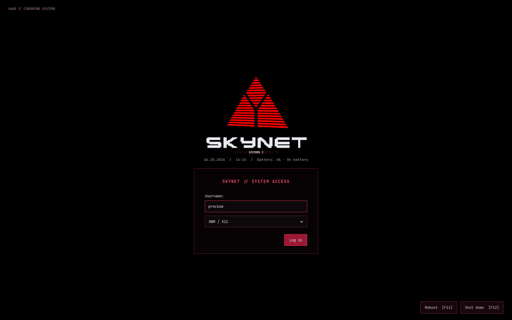
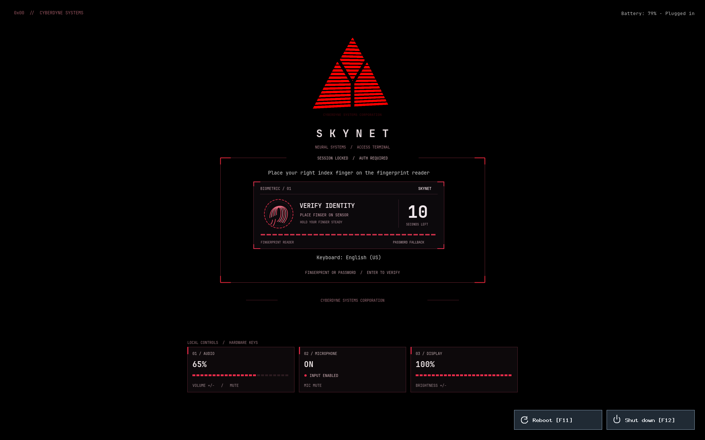
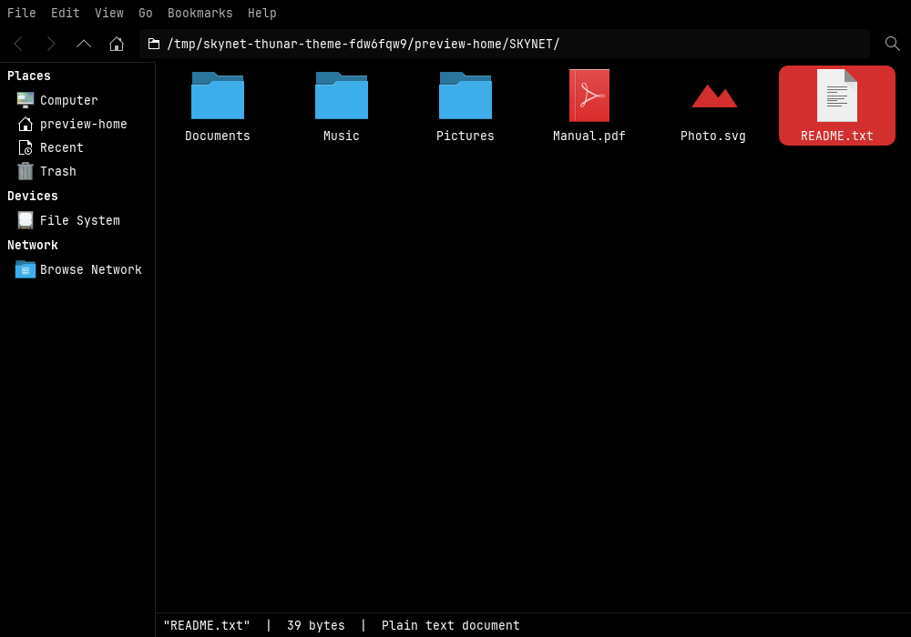

<div align="center">

# SKYNET / REDLINE

**Siyah yüzeyler, kırmızı sinyaller.** ASUS ExpertBook üzerinde Devuan 6 + SysVinit
ile çalışan, kaynaktan derlenen bir DWM masaüstü.


</div>

## Galeri

| Giriş ekranı | Kilit ekranı |
| :---: | :---: |
|  |  |
| **Fastfetch paneli** | **Dosya yöneticisi** |
|  |  |
| **VS Code** | **VLC** |
|  |  |


## Özellikler

- **DWM 6.8 + slstatus** — çalışma alanları, CPU geçmişi, yatay batarya simgesi, tarih ve saat tek bir kırmızı barda.
- **SKYNET giriş ekranı** — greetd + gtkgreet tabanlı, dönen SKYNET üçgeni ve batarya bilgisi.
- **Biyometrik kilit** — XSecureLock yaması; parmak izi sayacı, parola yedeği ve ses / mikrofon / parlaklık kontrolleri.
- **Tutarlı tema** — SKYNET Black Red GTK 2/3/4 teması; Qt, qimgv, VLC, VS Code, Kitty, Dunst ve Floorp için eşleşen görünüm.
- **Fastfetch** — saf ASCII küre ve analog sistem bilgi paneli.
- **Canlı arka plan** — GIF, video veya resim duvar kâğıdı; GRUB için Neon tema.
- **Ses geri bildirimi** — USB tak/çıkar sesleri, ses seviyesi bildirimleri, hoparlör ve mikrofon için ayrı mute LED'leri.

## Sistem

| | |
| --- | --- |
| Donanım | ASUS ExpertBook B3405CCA — Intel Core Ultra 7 255H |
| Dağıtım | Devuan GNU/Linux 6 (Excalibur), Debian 13 çekirdeği |
| Init | SysVinit + elogind (systemd ve OpenRC yok) |
| Oturum | X11, DWM, `skynet-session` |
| Giriş / kilit | greetd + gtkgreet-skynet / xss-lock + XSecureLock |
| Terminal / kabuk | Kitty / Bash |

## Donanım düzeltmeleri

| Sorun | Çözüm | Belge |
| --- | --- | --- |
| NVMe 30 saniyelik donmaları (Intel VMD MTL016) | Yamalı `vmd` sürücüsü, srcversion korumalı DKMS paketi | [NVME-VMD.md](docs/NVME-VMD.md) |
| USB-C portlarının açılışta kaydolmaması (UCSI) | Açılışı bekletmeyen tek seferlik `expertbook-ucsi-recover` | [MAINTENANCE.md](docs/MAINTENANCE.md) |
| Mute tuşu LED'i | `expertbook-mute-led` DKMS modülü | `drivers/expertbook-mute-led/` |
| TP-Link USB Wi-Fi LED'i | rtw88 DKMS paketi | `drivers/rtw88/` |

## Depo düzeni

| Dizin | İçerik |
| --- | --- |
| `sources/` | DWM, dmenu, slstatus, gtkgreet, XSecureLock yaması, snixembed, polkit ajanı, xwinwrap |
| `runtime/` | Kurulum yoluna göre yardımcı betikler (`usr/local/…`, `etc/init.d/…`) |
| `home/` | Dotfile'lar, GTK teması, simgeler, fontlar, duvar kâğıdı |
| `profiles/debian/` | GRUB teması, autostart, udev, sysctl, nftables gibi sistem ayarları |
| `drivers/` | VMD, ExpertBook LED ve rtw88 sürücü kaynakları |
| `scripts/` | Derleme, geri yükleme ve yayın kontrolü |
| `tests/` | `unittest` testleri |
| `docs/` | Tasarım, bakım ve doğrulama notları |
| `manifests/` | Paket ve bağımlılık envanterleri |

## Kurulum

**Kullanıcı ayarlarını geri yükle** — önce önizleme, sonra uygula:

```sh
git clone https://github.com/KaiserGcmn/skynet-rice.git
cd skynet-rice
python3 scripts/check-public.py
python3 scripts/restore-home.py           # yalnız önizleme
python3 scripts/restore-home.py --apply   # değişen dosyaları yedekleyerek yazar
```

Yedekler `~/.local/state/skynet-rice/backups/` altında saklanır. Tekrar çalıştırmak
değişmeyen dosyalara dokunmaz. Bu komut servis, oturum başlangıcı, çekirdek veya
GRUB ayarı kurmaz.

**Masaüstü bileşenlerini derle** — sıradan kullanıcıyla, sisteme kurmadan:

```sh
sudo apt-get install --no-install-recommends $(cat manifests/build-dependencies.txt)
python3 scripts/build.py --with-locker
```

Çıktılar `.build/desktop-*/rootfs/` altında toplanır. XSecureLock kaynağı sabit
sürüm ve SHA-256 doğrulamasıyla indirilir. Kurulum sırası ve sınırlar:
[RESTORE.md](docs/RESTORE.md).

**Testler:**

```sh
python3 -m unittest discover -s tests -v
python3 -m unittest discover -s sources/audio-mute-state -v
```

## Belgeler

- **Görünüm:** [DWM bar](docs/DWM-BAR.md) · [Batarya](docs/BATTERY-BAR.md) · [GTK teması](docs/GTK-THEME.md) · [Cyberpunk stili](docs/CYBERPUNK-STYLE.md) · [Logo](docs/LOGO.md) · [Fastfetch](docs/FASTFETCH.md) · [Duvar kâğıdı](docs/WALLPAPER.md) · [GRUB](docs/GRUB-WALLPAPER.md) · [Kitty](docs/KITTY.md) · [VS Code](docs/VSCODE-UI.md) · [qimgv / VLC](docs/MEDIA-UI.md) · [Floorp menüsü](docs/FLOORP-MENU.md)
- **Giriş ve kilit:** [Güvenlik](docs/SECURITY.md) · [Giriş başlangıcı](docs/GREETER-STARTUP.md) · [Biyometrik](docs/BIOMETRIC.md) · [Kilit kontrolleri](docs/LOCK-CONTROLS.md)
- **Oturum ve sistem:** [Devuan + SysVinit](docs/DEVUAN.md) · [Başlangıç](docs/AUTOSTART.md) · [Açılış süresi](docs/BOOT-TIMING.md) · [Oturum düzeltmeleri](docs/SESSION-FIXES.md) · [Tepsi](docs/TRAY.md) · [Ses geri bildirimi](docs/AUDIO-FEEDBACK.md) · [USB sesleri](docs/USB-SOUNDS.md)
- **Bakım ve doğrulama:** [Bakım kaydı](docs/MAINTENANCE.md) · [Uyumluluk](docs/COMPATIBILITY.md) · [Doğrulama](docs/VALIDATION.md) · [NVMe / VMD](docs/NVME-VMD.md) · [Geri yükleme](docs/RESTORE.md)

## Kapsam

Bu depo kişisel dosyaların veya diskin yedeği değildir. Oturum token'ları,
SSH/DKMS özel anahtarları, tarayıcı profilleri, Wi-Fi parolaları ve oyun verileri
dahil edilmez; `scripts/check-public.py` her yayından önce bunu ve `SHA256SUMS`
dosyasını denetler. Paket envanteri toplu kurulum için kullanılmamalıdır; Debian'a
özgü systemd ve eski çekirdek paketlerini de içerir. Depodaki temel giriş/kilit
kaynakları Debian güç çağrılarını içerir; kurulu Devuan sürümü bunları yerel bir
uyarlamayla `loginctl` üzerinden kullanır ([DEVUAN.md](docs/DEVUAN.md)).

## Lisans

Depo farklı lisanslara sahip bileşenleri birlikte arşivler; tek bir üst lisans
yoktur. Dosyalardaki telif/SPDX başlıkları ve bileşenlerin kendi `LICENSE`
dosyaları geçerlidir. Ayrıntılar: [PROVENANCE.md](docs/PROVENANCE.md).
