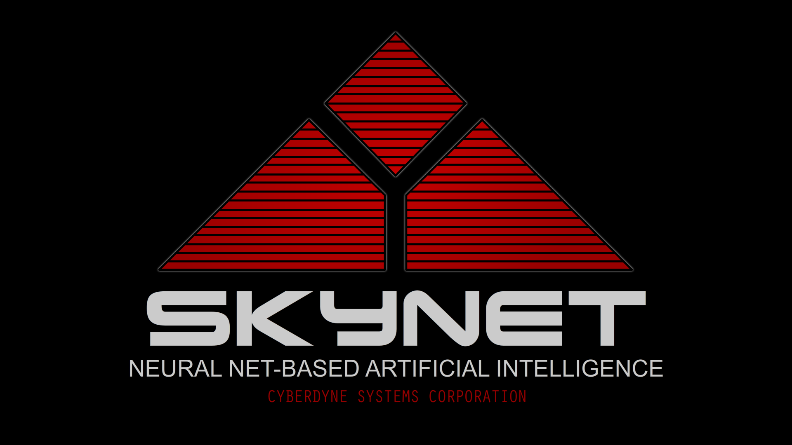

# SKYNET / REDLINE rice

KaiserGcmn'nin Debian 13 üzerinde kullandığı DWM masaüstünün kaynak kodları,
etkin ayarları ve **Devuan + OpenRC** geçiş hazırlığı. Anlık görüntü: 18 Ekim 2026.



| İçerik | Konum |
| --- | --- |
| DWM 6.8, dmenu, slstatus; gerçek config.h dosyaları | `sources/` |
| SKYNET giriş/kilit görünümü, XSecureLock yaması, xwinwrap | `sources/` |
| Ses, parlaklık, kilit, USB-C ve giriş yardımcıları | `runtime/` |
| Bash, Kitty, Dunst, Fastfetch, GTK, font, duvar kâğıdı | `home/` |
| Etkin `autostart.sh`, GRUB, TLP, udev, nftables, oturum ayarları | `profiles/debian/` |
| OpenRC başlangıç dosyası taslakları ve geçiş durumu | `profiles/openrc/`, [DEVUAN.md](docs/DEVUAN.md) |
| ExpertBook LED, TP-Link rtw88, VMD düzeltmesi | `drivers/` |
| APT paketleri ve VS Code/Node eklenti listeleri | `manifests/` |
| Önceki Debian bakım betikleri | `reference/debian-maintenance/` |

Devuan/OpenRC üzerinde henüz çalışma testi yapılmadı. Özellikle kilit
dinleyicisinin `systemd-run` kullanımı ve giriş/kilit ekranındaki güç düğmeleri
uyarlanmayı bekliyor. Bunlar [geçiş tablosunda](docs/DEVUAN.md) açıkça kayıtlı.
Kullanıcı ayarlarını geri yükleme komutu systemd servislerini veya oturum
başlatma dosyalarını kurmaz; servis/çekirdek/GRUB ayarları ayrıca değerlendirilir.

## Çek ve kullanıcı ayarlarını geri yükle

```sh
git clone https://github.com/KaiserGcmn/skynet-rice.git
cd skynet-rice
python3 scripts/check-public.py
python3 scripts/restore-home.py
# Önizlemeyi inceledikten sonra, masaüstü kullanıcısı olarak:
python3 scripts/restore-home.py --apply
```

`--apply`, değişecek dosyaların önceki hâlini
`~/.local/state/skynet-rice/backups/` altında saklar. Duvar kâğıdı ve Fastfetch
yolları yeni kullanıcı dizinine uyarlanır. Aynı komutun tekrar çalışması,
içeriği değişmeyen dosyalara dokunmaz.

## Derle

Debian/Devuan depolarından derleme bağımlılıklarını kurduktan sonra:

```sh
sudo apt-get install --no-install-recommends $(cat manifests/build-dependencies.txt)
python3 scripts/build.py --with-locker
```

Derleme sıradan kullanıcıyla yapılır; varsayılan paralellik iki iştir.
Çıktılar `.build/desktop-*/rootfs/` altında toplanır, çalışan sisteme kurulmaz.
XSecureLock kaynağı sabit sürüm ve SHA-256 doğrulamasıyla indirilir.
Bu derleme Debian'daki mevcut programları yeniden üretir; OpenRC uyarlamasını
otomatik tamamlamaz. Kurulum sırası ve sınırlar: [RESTORE.md](docs/RESTORE.md).

Bu depo kişisel dosyaların veya tüm diskin yedeği değildir. Oturum tokenları,
SSH/DKMS özel anahtarları, tarayıcı profilleri, Wi-Fi parolaları ve oyun
verileri dahil edilmedi. Paket envanteri topluca kurulum için kullanılmamalı;
Debian'a özgü systemd ve eski çekirdek paketlerini de içerir.

Kaynak ve lisans bilgileri: [PROVENANCE.md](docs/PROVENANCE.md).
