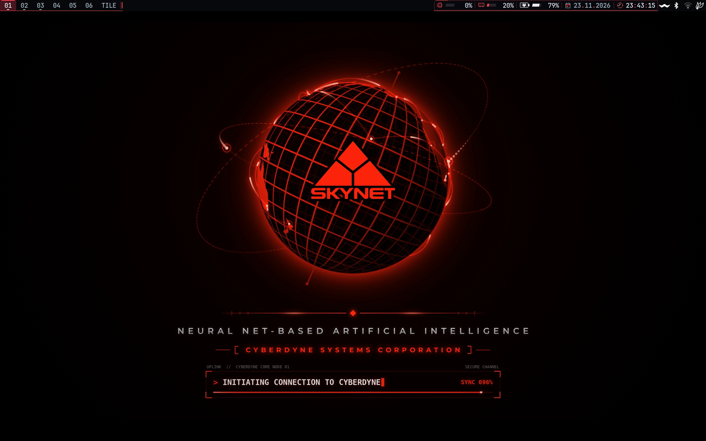
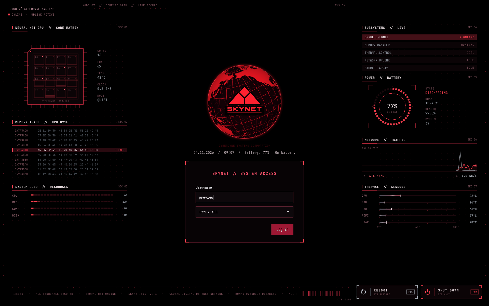
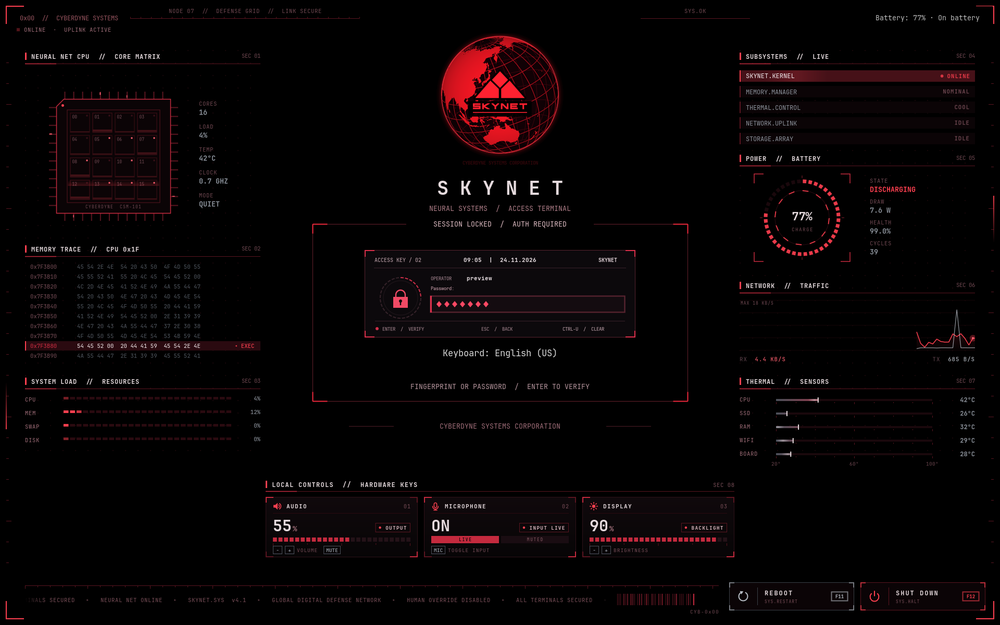
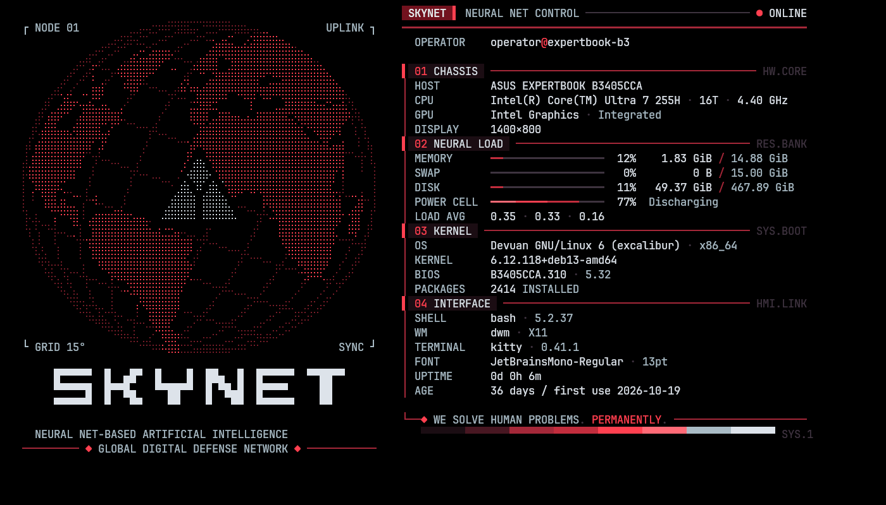

<div align="center">

# SKYNET / REDLINE

**Siyah yüzeyler, kırmızı sinyaller.** Devuan 6 + SysVinit üzerinde çalışan,
kaynaktan derlenen bir DWM masaüstü.




</div>

| Giriş ekranı | Kilit ekranı | Terminal |
| :---: | :---: | :---: |
|  |  |  |

## Özellikler

- **DWM 6.8 + slstatus** — çalışma alanları, CPU, RAM, pil, tarih ve saat tek kırmızı barda.
- **Giriş ve kilit ekranı** — greetd ve XSecureLock; ortak canlı HUD, parmak izi + parola, Reboot / Shut down.
- **Tema** — SKYNET Black Red GTK 2/3/4; Qt, Kitty, Dunst, VLC ve Floorp uyumlu; kırmızı simge teması, HUD imleci ve AMOLED siyah VS Code teması.
- **Duvar kâğıdı** — GIF, 4K dahil video veya resim (video yeniden kodlanmadan oynatılır); GRUB için Neon tema.
- **Ses** — USB ve şarj cihazı sesleri, hoparlör ve mikrofon için ayrı mute LED'leri.

## Sistem

| | |
| --- | --- |
| Dağıtım | Devuan 6 (Excalibur), SysVinit + elogind |
| Oturum | X11, DWM, Kitty |
| Giriş / kilit | greetd + gtkgreet-hud / xss-lock + XSecureLock |

## Kurulum

```sh
git clone https://github.com/KaiserGcmn/skynet-rice.git
cd skynet-rice
python3 scripts/restore-home.py           # önizleme
python3 scripts/restore-home.py --apply   # uygula (değişen dosyalar yedeklenir)
python3 scripts/build.py --with-locker    # bileşenleri derle, sisteme kurmaz
```

Derleme bağımlılıkları `manifests/build-dependencies.txt` içindedir. Ayrıntılar:
[RESTORE.md](docs/RESTORE.md). Testler: `python3 -m unittest discover -s tests`.

## Belgeler

- **Görünüm:** [DWM bar](docs/DWM-BAR.md) · [GTK teması](docs/GTK-THEME.md) · [Cyberpunk stili](docs/CYBERPUNK-STYLE.md) · [Fastfetch](docs/FASTFETCH.md) · [Duvar kâğıdı](docs/WALLPAPER.md) · [İmleç](docs/CURSOR.md) · [VS Code](docs/VSCODE-UI.md)
- **Giriş ve kilit:** [Güvenlik](docs/SECURITY.md) · [Biyometrik](docs/BIOMETRIC.md) · [Kilit kontrolleri](docs/LOCK-CONTROLS.md)
- **Sistem:** [Devuan + SysVinit](docs/DEVUAN.md) · [Ses](docs/AUDIO-FEEDBACK.md) · [USB sesleri](docs/USB-SOUNDS.md) · [NVMe / VMD](docs/NVME-VMD.md) · [Bakım kaydı](docs/MAINTENANCE.md)

Tüm notlar [`docs/`](docs/) altındadır.

## Kapsam ve lisans

Bu depo bir disk yedeği değildir; anahtarlar, parolalar ve tarayıcı profilleri
dahil edilmez (`scripts/check-public.py` denetler). Bileşenler kendi lisanslarını
korur; ayrıntılar: [PROVENANCE.md](docs/PROVENANCE.md).
