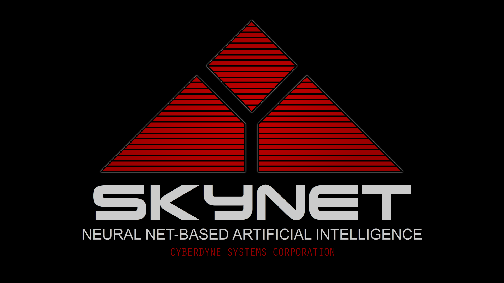

# SKYNET / REDLINE rice

KaiserGcmn'nin DWM masaüstünün kaynak kodları ve ayarları. İlk arşiv Debian 13
üzerinden 18 Ekim 2026'da alındı; güncel sistem **Devuan 6 + SysVinit/elogind**.



| İçerik | Konum |
| --- | --- |
| DWM 6.8, dmenu, slstatus; gerçek config.h dosyaları | `sources/` |
| SKYNET giriş/kilit görünümü, XSecureLock yaması, xwinwrap | `sources/` |
| Ses, parlaklık, kilit, USB-C ve giriş yardımcıları | `runtime/` |
| Bash, Kitty, Dunst, Fastfetch, GTK, font, duvar kâğıdı | `home/` |
| Etkin `autostart.sh`, GRUB, TLP, udev, nftables, oturum ayarları | `profiles/debian/` |
| Güncel SysVinit başlangıç düzeni ve arşiv sınırları | [DEVUAN.md](docs/DEVUAN.md) |
| ExpertBook LED, TP-Link rtw88, VMD düzeltmesi | `drivers/` |
| APT paketleri ve VS Code/Node eklenti listeleri | `manifests/` |
| Önceki Debian bakım betikleri | `reference/debian-maintenance/` |

Kullanılmayan systemd servis arşivleri, eski kilit başlatıcısı ve OpenRC
taslakları 28 Ekim 2026'da kaldırıldı. Çalışan sistem SysVinit hizmetlerini ve
`skynet-session` içindeki `xss-lock` gözetimini kullanır; denetim kapsamı
[COMPATIBILITY.md](docs/COMPATIBILITY.md) içindedir. Depodaki temel giriş/kilit
kaynakları hâlâ Debian güç çağrılarını içerir; kurulu Devuan sürümünün yerel
uyarlaması olmadan derleme çıktısı kurulmaz. Kullanıcı ayarlarını geri yükleme
komutu servis, oturum başlangıcı, çekirdek veya GRUB ayarlarını kurmaz.

## Çek ve kullanıcı ayarlarını geri yükle

```sh
git clone https://github.com/KaiserGcmn/skynet-rice.git
cd skynet-rice
python3 scripts/check-public.py
python3 scripts/restore-home.py
# Önizlemeyi inceledikten sonra, masaüstü kullanıcısı olarak:
python3 scripts/restore-home.py --apply
```

`--apply`, değişecek dosyaların önceki hâlini
`~/.local/state/skynet-rice/backups/` altında saklar. Fastfetch, saf ASCII küre
ve SKYNET yazısıyla sistem bilgi panelini gösterir; animasyon yardımcısı kurmaz. Aynı komutun tekrar çalışması,
içeriği değişmeyen dosyalara dokunmaz.

## Derle

Debian/Devuan depolarından derleme bağımlılıklarını kurduktan sonra:

```sh
sudo apt-get install --no-install-recommends $(cat manifests/build-dependencies.txt)
python3 scripts/build.py --with-locker
```

Derleme sıradan kullanıcıyla yapılır; varsayılan paralellik iki iştir.
Çıktılar `.build/desktop-*/rootfs/` altında toplanır, çalışan sisteme kurulmaz.
XSecureLock kaynağı sabit sürüm ve SHA-256 doğrulamasıyla indirilir.
Bu derleme yerel Devuan kaynak yamasını otomatik uygulamaz.
Kurulum sırası ve sınırlar: [RESTORE.md](docs/RESTORE.md).

Bu depo kişisel dosyaların veya tüm diskin yedeği değildir. Oturum tokenları,
SSH/DKMS özel anahtarları, tarayıcı profilleri, Wi-Fi parolaları ve oyun
verileri dahil edilmedi. Paket envanteri topluca kurulum için kullanılmamalı;
Debian'a özgü systemd ve eski çekirdek paketlerini de içerir.

Kaynak ve lisans bilgileri: [PROVENANCE.md](docs/PROVENANCE.md).
