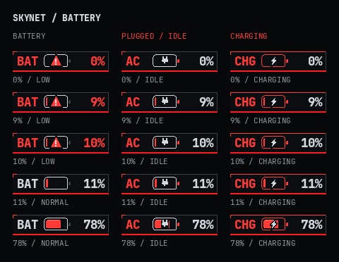
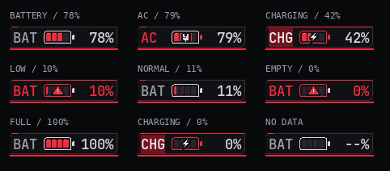
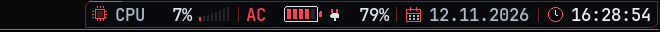
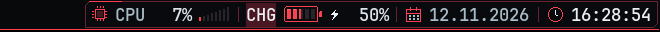
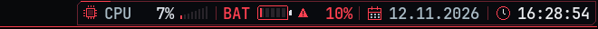

# Yatay batarya simgesi — 26 Ekim 2026

2 Kasım'daki genel bar görünümü güncellemesi [DWM-BAR.md](DWM-BAR.md)
içindedir. Aşağıdaki pil davranışı korunur; renkler ve panel çerçevesi yeni
bar paletine uyarlanır. Aktif şarj etiketi açık yazılı kırmızı rozet kullanır.

DWM barındaki beş ayrı pil hücresi yerine ince, yuvarlatılmış yatay pil
gövdesi çizilir. Tek piksel açık renk çerçeve, kırmızı doluluk ve koyu arka
plan mevcut SKYNET paletinden gelir. Dolgunun üst kenarındaki hafif açık
kırmızı çizgi hacim verir. Dolgu yüzdeye göre soldan sağa genişler; sıfırda
boş, yüzde yüz olduğunda doludur.

`Charging` durumunda etiket kırmızı `CHG` olur; gövde, uç ve panelin üst
çizgisi kırmızı yanar. Gövdenin içindeki açık renk şimşek, koyu konturuyla
hem boş hem dolu pil üzerinde okunur. Adaptör bağlıyken şarj sınırında bekleme
veya `Full` durumunda kırmızı `AC` etiketi, kırmızı uç ve açık renk fiş
gösterilir. Pil gövdesi ve panel üst çizgisi normal renginde kalır. Bu,
adaptöre bağlı beklemeyi aktif şarjdan ayırır; şimşek yalnız `Charging` içindir.
Gösterge sabittir; animasyon zamanlayıcısı veya ek arka plan süreci yoktur.

Pil seviyesi **%0–10 dahil** olduğunda, adaptör/şarj durumu yoksa pilin
üzerinde kırmızı uyarı üçgeni ve açık renk ünlem görünür. Yüzde ve BAT
etiketi de kırmızı olur. **%11'de uyarı kalkar.** `AC` ve `CHG` durumlarında
düşük yüzdeye rağmen üçgen gösterilmez; fiş veya şimşek korunur.
Geçersiz/eksik yüzde düşük pil sayılmaz. Yüzde biliniyor fakat güç durumu
`?` ise adaptör bağlantısı doğrulanamadığından düşük pil uyarısı gösterilir.

Sayısal yüzde korunur. Geçersiz/eksik veri `--%` ve boş gövde
olarak gösterilir. Panel genişliği yüzde ve şarj durumundan bağımsızdır;
gerçek oturum ekranının font ölçüleriyle 136 px, bar yüksekliği 30 px'dir.
Önceki özel Xephyr ekranında ölçülen 122/25 px farklı ekran font ölçeğinden
gelir. Bu düzeltme font, panel genişliği veya bar yüksekliği ayarını değiştirmez.
Panel, CPU bölümüne uyumlu çelik rengi kenar ve kırmızı köşe detayı kullanır.
CPU, tarih/saat, etiketler, sistem tepsisi, bar ayırıcıları ve alt kırmızı
çizgi korunur. Simge Xlib ile çizilir; ikon fontu, resim veya yeni bağımlılık
gerektirmez.

## Kaynak ve etkinleştirme

Çizim `sources/dwm/dwm.c` içindedir. `sources/slstatus/config.h` içindeki
üretici Linux'ta `Full`/`Not charging` durumunda
`/sys/class/power_supply/*/type=Mains` ve `online=1` bilgisini doğrular.
Adaptör adı sabit kodlanmaz; farenin pili veya USB cihazının `online` değeri
adaptör sanılmaz. Onaylanmış bekleme mevcut `•` durum işaretiyle aktarılır.
Adaptör çevrimdışıysa `↓`, bilgi eksik/bozuksa `?` üretilir. `Charging` için
`↑`, `Discharging` için `↓` korunur. Yeni protokol alanı yoktur; önceki DWM
sürümü de bu çıktıyı okuyabilir. TLP, şarj sınırı, yüzde hesabı ve saniyede bir
örnekleme değişmez. Bekleme kontrolü dış komut veya yeni süreç başlatmaz.

`profiles/debian/rootfs/etc/slstatus/config.h` aynı kaynak ayarını taşır.

Makinedeki DWM kurulurken mevcut
`~/.local/share/skynet-rice/devuan-source.patch` geçici kaynak kopyasına
`patch --batch --fuzz=0 -p1` ile uygulanır; ardından `sources/dwm` içinde
`make` çalıştırılır. Bu yerel katman kompakt bar, CPU görünümü ve tuş bağlarını
korur. 26 Ekim'deki kurulumda yama dosyası değiştirilmemiştir; 2 Kasım'da
kompakt CPU çizimi depoya taşındığı için yalnız eski CPU yama bölümü
kaldırılmıştır. Güncel derleme ayrıntıları DWM-BAR.md içindedir.

Doğrulanan programlar `/usr/local/bin/dwm` ve `/usr/local/bin/slstatus`
konumlarına atomik olarak, root:root ve 0755 izinleriyle kurulur.
Çalışan pencere yöneticisi kapatılmaz. Bu DWM
sürümünde canlı çizim yenileme bulunmadığından yeni simge **bir sonraki
DWM oturum açılışında** etkinleşir.

## Doğrulama

- `python3 -m unittest discover -s tests -p 'test_battery*.py' -v` (6 test):
  yüzde sınırları, şarj/dolu/boşalma/bilinmeyen durumları ve bozuk veri sınandı.
  Sahte sysfs ile adaptörün bağlı/ayrılmış olması, birden fazla adaptör,
  farklı adlar, çevre birimleri ve eksik/bozuk `online` verisi sınandı.
  Şimşek kararı yüzdeye göre verilmez; yalnız şarj durumuna bağlıdır.
- Uyarı eklenirken penceresiz X11 çizim tamponunda önceki ve yeni çizim
  karşılaştırıldı: %0, 1, 9, 10, 11, 78, 100 ve bilinmeyen yüzde; dört güç
  durumu; 30 ve 25 px yükseklik (64 durum). Gerçek masaüstü görüntüsü okunmadı.
  16 düşük pil görünümünde üçgen/ünlem doğrulandı. Kalan 48 görünüm, tüm
  `AC`/`CHG` durumları dahil, önceki çizimle piksel piksel aynıydı.
  Sabit panel genişliği, kesintisiz alt çizgi ve GC ayarları korundu.
- Önceki pil görünümü değişikliklerinde tam DWM özel ekranda çalıştırıldı;
  test autostart betikleri boştu.
  Gerçek oturumdaki uygulamalar ve sistem servisleri başlatılmadı/kapatılmadı.
- Mevcut Devuan yaması sapma kabul etmeden uygulandı, derleme uyarısız bitti.
  Fontlar, renk tanımları ve CPU işlevi değiştirilmedi.

## %80 sınırında %78 bekleme

26 Ekim 2026 kontrolünde `ADP1/online=1`, `BAT0/capacity=78`,
`BAT0/status=Not charging`, `current_now=0` ve durdurma eşiği `80` idi.
Bu bir gösterge hatası değildir. ASUS, %80 modunda yeniden şarjın %78'in
altında başladığını açıklar; gözlenen durum bu davranışla uyumludur.
Bu cihaz Linux'ta yalnız durdurma eşiğini sunar; başlangıç eşiği okunamadı
ve zorla şarj başlatılmadı. TLP ayarları değiştirilmedi.
[ASUS açıklaması](https://www.asus.com/support/FAQ/1032726/),
[TLP ASUS desteği](https://linrunner.de/tlp/settings/bc-vendors.html#asus).

Örnekler test verisiyle oluşturulmuştur; cihazın gerçek pil seviyesini göstermez.

## Batarya simgesi yenilemesi — 4 Kasım 2026

Yalnız `batterypanel` içindeki pil gövdesi/doluluk/durum simgesi çizimi
sadeleştirildi. Gövde 34×16 px, küçük köşe yarıçapı, açık çelik kontur ve
ince alt kenar kullanır. İçeride dört koyu yuva vardır; kırmızı doluluk
seviyeye göre bu yuvaları soldan sağa doldurur. İnce açık kırmızı üst kenar
hücreleri ayırır. Boş hücreler de seçilebilir. Kontur ve uç daha belirgindir.
Şarj şimşeği, bekleme fişi ve düşük pil üçgeni koyu ayırıcı zemine sahiptir.

Yüzde, BAT/AC/CHG etiketleri, panel genişliği, renk paleti, diğer göstergeler
ve durum ayrıştırıcıları değiştirilmedi. %0–10 dahil uyarı yalnız pilde
kalır; %11'de kalkar, şarjda/AC'de görünmez. Ek süreç, animasyon, resim veya
ikon fontu yoktur. Eski yerel yapılandırma yaması korunarak yalnız DWM
uyarısız derlendi. Altı mevcut batarya testi geçti; özel, görünmeyen Xephyr
ortamında dokuz pil durumu görüntülendi ve DWM çalışmayı sürdürdü. Kaynağın
`batterypanel` dışındaki kısmı işlem öncesi kopyayla birebir karşılaştırıldı.

Kurulum `/usr/local/bin/dwm` dosyasını atomik değiştirir; çalışan pencere
yöneticisi kapatılmaz. Görünüm **sonraki oturum açılışında** etkinleşir.
İkili SHA-256: `e9b07398cf0d6c8f633a2dd686b84ec18c9d206dab70bbd68820d6db27702175`.
Aşağıdaki seviyeler test verisidir.

## Ayrı durum simgesi ve beş hücre — 12 Kasım 2026

Pil gövdesi beş okunaklı kırmızı hücreyle çizilir. Doluluk seviyeye göre
ilerler; yüzde verisi değiştirilmez. Önceki doluluğun üzerine bindirilen
fiş/şimşek/uyarı yerine gövdenin sağında sabit genişlikli bir durum alanı
vardır. AC beklemesinde iki kırmızı uçlu açık renk fiş, şarjda açık renk
şimşek, normal pilde aşağı ok; %0–10 dahil yalnız pilde kırmızı ünlemli
üçgen gösterilir. Eksik veri `--%` ve kısa çizgi olarak kalır.

BAT/AC/CHG etiketleri korunur. Durum alanı paneli 19 px genişletir; yüzde
ve güç kaynağı değiştiğinde alan genişliği sabit kalır. Birleşik panelin
çerçevesi, CPU/tarih/saat, tepsi ve klavye kısayolları değişmez. Şarj limitine
ulaşmış adaptör bağlantısı aktif şarj gibi gösterilmez; BIOS/TLP ayarlarına
dokunulmaz. Animasyon veya yeni arka plan süreci eklenmez.

Önceki ikili kaynak + yerel yama ile birebir yeniden üretildi. Kaynak farkı
yalnız `batterypanel` içinde; yeni derleme uyarısız. Altı batarya testi geçti.
Özel Xephyr ekranında %79/%80 AC, %50 şarj, %10/%11 pil, %0/%100 pil,
%10 şarj ve eksik veri görsel olarak sınandı. Normal Polkit doğrulamasıyla
ikili atomik olarak kuruldu; çalışan oturum kapatılmadı. Görünüm sonraki
oturum girişinde etkinleşir. Geçici derleme/test/kurulum dosyaları temizlendi.

İkili SHA-256: `6a781d994e5a4dd470a254d5dafdd657af44185b2c659069b59a64b58ec73b5a`.

