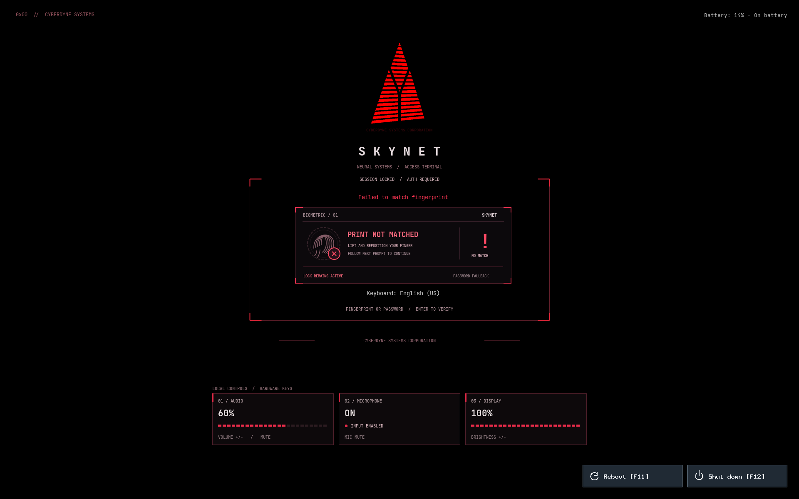
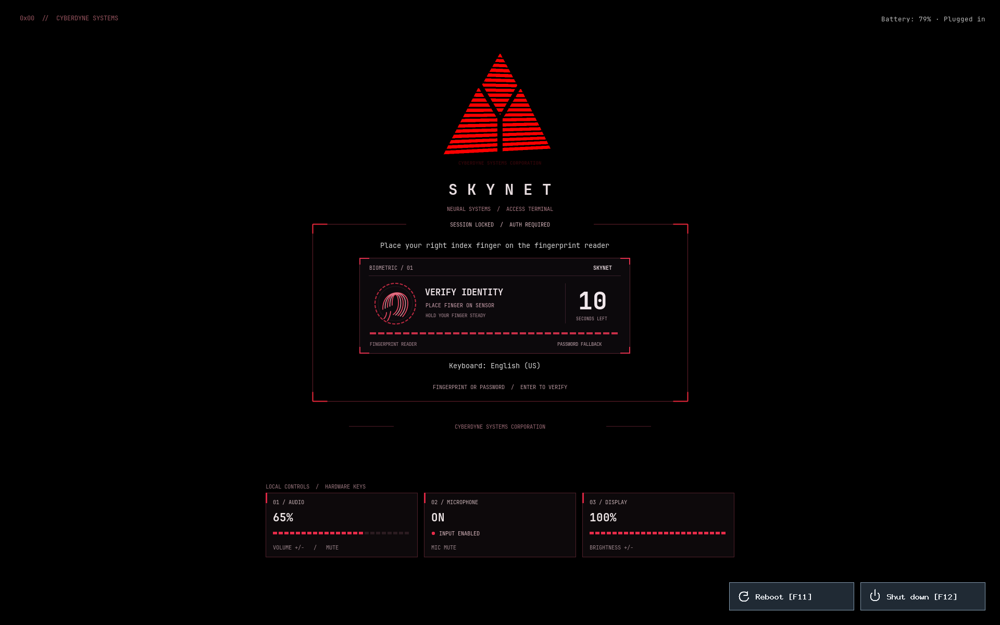

# Biyometrik sayaç görünümü — 23 Ekim 2026

## Parmak izi sonuç paneli — 3 Kasım 2026

Parmak izi eşleşmediğinde aynı 520×184 çerçevede kırmızı çarpı rozeti,
“PRINT NOT MATCHED” ve “LOCK REMAINS ACTIVE” gösterilir. Süre aşımı
“SCAN TIMED OUT”, okuma yönlendirmesi “ADJUST YOUR FINGER”, bilinen sensör
hatası “READER ERROR” görünümünü seçer. Yeni tarama mesajında normal sayaç
geri gelir. Metinler mevcut İngilizce SKYNET arayüzüne uygundur.

Sınıflandırma yalnız kurulu pam_fprintd 1.94.5'in bilinen İngilizce
mesajlarıyla tam eşleşir; bilinmeyen/parola hataları eski genel görünümde
kalır. Sensörün özgün mesajı panelin üstünde korunur. Paket kaynağındaki
`send_err_msg`/`send_info_msg` yolları kontrol edildi: süre aşımı INFO,
eşleşmeme ve yeniden konumlandırma ERROR olarak iletilir. Bu ayrım sınandı.
Yerel sayaç sıfıra indi diye başarısızlık üretilmez.

Değişiklik yalnız `DisplayMessage` çizimini ve bu mesajlarda görünüm
sayacının durmasını kapsar. `Prompt`, protokol yanıtları, parolanın bellekten
silinmesi, PAM deneme sınırları, mevcut bir saniyelik mesaj beklemesi ve
çıkış durumuyla kilit açma kararı korunur. İlave bekleme veya giriş yolu
eklenmedi. Retry yönlendirmesi yeni mesaj gelene kadar ekranda kalabilir;
doğrulama hizmeti aynı sırada çalışmaya devam eder.

`test_biometric_notice.py`: bilinen sensör mesajları, genel parola hatası,
bilinmeyen mesaj/null için geri dönüş ve çizim sınırları geçti. Özel Xephyr
ve sahte authproto ile eşleşmeme → yeniden tarama → yerleştirme uyarısı →
INFO süre aşımı → sensör hatası → genel hata → maskeli parola geçişleri
sınandı. Hata mesajı eski sayaçla üzerine yazılmadı; başarısız parola ve
Escape sonrası kilit/klavye/fare yakalamaları korundu. Yalnız başarılı
sahte authproto sonucu kilidi açtı. Gerçek kullanıcı oturumu, PAM ve sensör
bu testte kullanılmadı.

Temiz kaynak üzerinde iki yama katmanı sıfır fuzz ile yeniden uygulandı ve
derlenen kaynakla eşleşti. PIE/full RELRO/yürütülemez yığın korundu.
Yalnız `auth_x11_skynet` atomik root:root 0755 yenilenir; PAM, ana kilit,
başlatıcı, authproto ve dekor/medya yardımcılarının hashleri korunur.

## Kilit paneli yenilemesi — 3 Kasım 2026

Yalnız kilit ekranının parmak izi paneli yenilendi. Greetd parola ile giriş
politikasını korur; GTK panelinin çizimi değiştirilmedi. Aşağıdaki 23 Ekim
notları önceki ortak tasarımın geçmişidir.

Yeni panel 520×184 px: siyaha yakın zemin, ince koyu kırmızı çerçeve, belirgin
köşe işaretleri, sıcak beyaz metin ve büyük saniye göstergesi. Yerel Cairo
çizimi parmak izi simgesini, 28 parçalı dairesel sayacı ve 30 parçalı yatay
sayacı oluşturur. İki gösterge de kalan süreyi temsil eder; okuma kalitesi
veya eşleşme yüzdesi göstermez. Son üç saniye parlak kırmızıdır, yanıp sönmez.
Sıfırda “WAITING FOR RESULT” gösterilir; süre dolması başarı/başarısızlık
kararı üretmez. Hangi parmağın istendiğini belirten PAM mesajı korunur.

Biyometrik görünümde yinelenen kullanıcı başlığı ve tarih satırı kaldırıldı;
panel mevcut SKYNET başlığı ve dış çerçevenin içine sığar. Parola ekranındaki
başlık, saat/tarih, maskeli giriş ve klavye göstergeleri korunur.

Çizimin okunabilir kaynağı
[`skynet-biometric.h`](../sources/xsecurelock-power/skynet-biometric.h).
Makinede yeniden derleme için `devuan-source.patch` içindeki kilit yaması da
aynı başlık ve `DisplayMessage` yerleşimiyle güncellendi. Diğer makine
katmanları korunur. Temiz kaynakta iki yama katmanı `--fuzz=0` ile uygulandı;
derlenen kaynakla birebir eşleşti. `DisplayMessage` dışındaki auth kaynak
kodunun önceki sürümle aynı olduğu doğrulandı. Sayaç süresi 10 saniyedir.

Yalnız `/usr/local/libexec/auth_x11_skynet` root:root, 0755 olarak atomik
kurulur. PAM, authproto_pam, ana kilit programı, başlatıcı, logo/dekor ve
medya kontrol yardımcıları hash ile korunur. Servis veya oturum yeniden
başlatılmaz; görünüm bir sonraki kilitte kullanılır. Yeni paket, servis veya
medya oynatımı eklenmez.

Özel, kimlik doğrulamalı ve TCP dinlemeyen Xephyr ekranında sahte authproto
ile sıfırda kilidin korunması, hatalı girişin reddi, Escape, klavye/fare
yakalamaları, maskeli parola geri dönüşü ve yalnız başarı yanıtıyla açılma
sınandı. Bu test gerçek PAM/sensör veya kullanıcı parolasını kullanmaz;
canlı masaüstü kilitlenmez. PIE, full RELRO ve yürütülemez yığın doğrulandı.
Derleme yalnız upstream'in mevcut üç strncpy uyarısını verdi.

İlk tam ekran yerleşimi ve 10/5/2/0 saniyelik panel çizimleri incelendi.
Gizli Xephyr ana penceresinde sonraki ekran görüntülerinde bazı sabit dekor
alanları eksik yakalandı; aynı durum eski kurulu auth yardımcısıyla da
tekrarlandı. Bu gözlem yeni panelin doğrulama davranışını etkilemedi;
gerçek kilit ekranında uzun süreli görsel test yapıldığı iddia edilmez.

2 Kasım 2026 tercihi: parmak izi yalnız kilit ekranında etkin bırakıldı.
Greetd artık parola ile giriş yapar; bu bölümde anlatılan greetd parmak izi
paneli mevcut giriş akışında gösterilmez. Kayıtlı parmaklar ve kilit ekranının
paneli korunur. Güncel politika ve testler [SECURITY.md](SECURITY.md) içindedir.

Greetd/GTK ve XSecureLock parmak izi bekleme paneli aynı SKYNET tasarımını
kullanır: yerel çizilen parmak izi simgesi, büyük saniye rakamı, yirmi kırmızı
bölüm ve ince köşe çerçeveleri. Son üç saniye daha parlaktır; yanıp sönme yoktur.
Süre sıfırda sabitlenir ve sonraki ekranı doğrulama hizmetinin yanıtı belirler.
Yeni medya dosyası, arka plan işlemi veya paket kurulmadı.

## Kaynak ve derleme

Bu depo Debian kaynak görüntüsüdür. Makinedeki mevcut Devuan değişiklikleri
`~/.local/share/skynet-rice/devuan-source.patch` içinde tutulur. Bu yama DWM
ayarları, greetd asenkron doğrulama/sayaç entegrasyonu ve XSecureLock yamasının
makineye özgü sürümünü içerir; bu işlem yalnızca sayaç çizimini güncelledi.
Yamayı deponun geçici kopyasında `patch --batch --fuzz=0 -p1` ile uygulayın.
Asıl depoya tekrar tekrar uygulamayın.

- GTK: `sources/gtkgreet-skynet` içinde `make`; yeni `skynet-biometric.h`
  dosyası depo kaynağıdır. Makine yaması `window.c`/`window.h` entegrasyonunu sağlar.
- Kilit arayüzü: SHA-256 doğrulanmış XSecureLock 1.9.0 kaynağına, Devuan
  katmanı uygulandıktan sonraki `sources/xsecurelock-power/local-changes.patch`
  uygulanır. Bu iç yama aynı çizim başlığını da içerir.
- XSecureLock: `autoreconf -fi`; `./configure --prefix=/usr/local
  --libexecdir=/usr/libexec --without-pam
  --with-default-authproto-module=authproto_pam
  --with-default-auth-module=auth_x11 --without-pandoc`; `make -j2 auth_x11`.
  Debian hardening CFLAGS/CPPFLAGS/LDFLAGS ve `-D_DEFAULT_SOURCE` kullanılır.
  Yalnızca `auth_x11` çıktısı `/usr/local/libexec/auth_x11_skynet` olarak kurulur.
  Ana kilit programını ve PAM yardımcısını bu görünüm için yeniden kurmayın.
- `libcairo2-dev` doğrudan derleme bağımlılığıdır; GTK üzerinden zaten kuruluydu.
- Aktif GTK stili `/etc/greetd/skynet.css`; eski `fingerprint-countdown` ve
  `fingerprint-meter` kuralları yerine `#fingerprint-panel { background:
  transparent; }` kullanılır. Panel kendi renklerini çizer.

## Doğrulama

Görünmeyen bir ana pencere altında özel Xephyr ekranı kullanıldı. Hem GTK/X11
hem Cage/Wayland üzerinde sahte greetd IPC ile geri sayım, maskeli parola,
hatalı girişin reddi ve yalnızca başarı yanıtından sonra `start_session`
gönderilmesi sınandı. Kilidin görsel yardımcısı sahte `authproto` üzerinden
süre bitimi, parola yanıtı ve başarısız/başarılı çıkış durumlarıyla sınandı.
Mevcut kilit dekoruyla yerleşim ve her iki arayüzün ekran görüntüleri incelendi.

Gerçek oturum kilitlenmedi/yeniden başlatılmadı; gerçek parola, sensör veya
parmak izi kayıtları kullanılmadı. PAM, `authproto_pam`, ana kilit programı,
başlatıcılar ve mevcut logo yardımcısının SHA-256 değerleri korundu. GTK
`actions.c`, `proto.c`, `proto.h`, `gtkgreet.c` ve logo çizimi değişmedi.
10 saniyelik süre, PAM yanıtları ve parola geri dönüşü aynı kaldı.

Derleme başarılı; XSecureLock upstream `strncpy` satırındaki üç mevcut derleyici
uyarısı dışında yeni derleyici uyarısı yok. Yeni yama özgün arşive ve tüm
makine katmanı temiz kaynak kopyasına `--fuzz=0` ile uygulanarak doğrulandı.
Kurulum servisleri yeniden başlatmaz; yeni görünüm ekranlar sonraki açıldığında
kullanılır. Geçici derleme, test, indirme ve ekran görüntüleri temizlenir.
