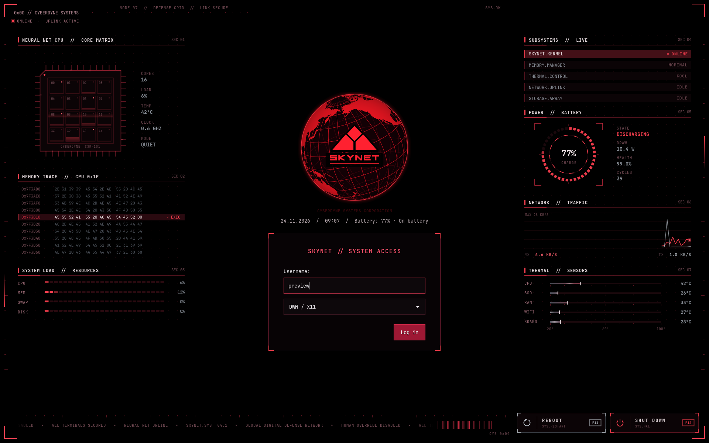

# SKYNET cyberpunk dokunuşu — 12 Kasım 2026

## Kilit kapanışındaki BadWindow uyarıları — 22 Kasım 2026

Kilit her açıldığında xsecurelock günlüğüne üç uyarı düşüyordu:
`Got non-fatal X11 error: BadWindow`. Uyarıyı ayrıntılı yazan geçici bir
derleme, üçünün de `DestroyWindow` (istek 4) olduğunu ve kilidin arka plan,
saver ve doğrulama pencerelerine ait olduğunu gösterdi.

**Neden:** XSecureLock 1.9.0 kapanışta önce composite overlay penceresini
bırakıyor. Sunucu, son istemci bırakınca overlay'i içine alınmış
pencerelerle birlikte yok eder. Ardından gelen `XDestroyWindow` çağrıları
artık olmayan pencereleri hedef aldığı için hata verir. Bu durum özgün
1.9.0'da da vardır; yerel butonlar ve fare üzeri değişiklikleri öncesindeki
yedek ikilide de aynı üç uyarı görüldü.

**Düzeltme (makine katmanı, `main.c`):** sıra değişti. Önce obscurer
penceresi silinir (önceki gibi, hiç görünmemesi için), ardından güç
butonu özellikleri ile doğrulama, saver ve arka plan pencereleri, en son da
overlay bırakılır. Kilit mantığı, kimlik doğrulama ve girdi yakalama
değişmedi.

**Doğrulama (Xephyr 1920x1200, 96 DPI, sahte authproto):**

| Senaryo | Sonuç | BadWindow |
| --- | --- | --- |
| Doğru şifre | Kilit açılıyor | 0 (kurulu eski ikili: 3) |
| Butonların üzerine gelme, F11 test modu | Komut çalışmıyor | 0 |
| 12 s karartma, ardından açma | Kilit açılıyor | 0 |
| Yanlış şifre | Kilit kapalı kalıyor | 0 |

Açıldıktan sonra `_SKYNET_POWER_UI*` özellikleri silinmiş durumda.

Yedek: `~/.local/state/skynet-rice/backups/lock-teardown-20261122/`.

## Giriş ekranı (greetd) HUD — 21 Kasım 2026

Bilgisayar açılınca gelen GTK giriş ekranı, kilit ekranıyla aynı canlı HUD'u
gösterir. Bu panellerin hepsi giriş ekranında da var:

- CPU çipi,
- hafıza izi,
- yük çubukları,
- SUBSYSTEMS // LIVE,
- POWER // BATTERY halkası,
- ağ grafiği,
- THERMAL // SENSORS,
- alt şerit ve kenar tarayıcıları.

Dönen SKYNET amblemi, yazı ve giriş kutusu ortada aynen kalır.

- **Ortak kod:** `sources/xsecurelock-style/cyber-hud.h` artık
  `HUD_NO_X11` ile X11'siz derlenebilir. X11 bölgeleri, MIT-SHM tamponları ve
  kök pencere özellik okuma/yazması bu anahtarın arkasındadır. Kilit
  ekranının saver'ı için önişlemci çıktısı değişmedi (bayt bayt aynı).
- **Giriş ekranı katmanı:** `sources/gtkgreet-hud/skynet-hud.h`.
  - Pencerenin arka planına statik çerçeve görselini, üstüne de canlı
    parçaları çizer.
  - 1920x1200 tasarım ekrana sığacak biçimde ölçeklenir ve ortalanır.
  - Yalnızca zamanı gelen bölgeler yenilenir.
  - Amblem ve HUD aynı yaklaşık 30 fps'lik kare dilimlerini kullanır
    (`SKYNET_FRAME_SLOT_US`). Böylece ikisi ayrı karelerde değil, aynı karede
    çizilir.
- **Statik çerçeve:** `render-cyberpunk.py --blank OUT.png` paneller
  çizilmiş, ortası boş, siyah bir görsel üretir. Depoda
  `runtime/usr/local/share/hud-greeter/hud-background.png` olarak durur ve
  aynı yola kurulur. Görsel yoksa canlı parçalar siyah zemine çizilir.
- **Butonlar:**
  - Reboot/Shut down kilit ekranındakiyle aynı çizilir ve aynı yerdedir:
    1400,1118, 240x54, aralarında 12 px.
  - Fare üzerine gelince ya da klavye odağındayken vurgulanır.
  - İstek sürerken REBOOTING/SHUTTING DOWN · STAND BY gösterir.
  - Reddedilirse 4 saniye BLOCKED · ACTION REFUSED gösterir. Eski modal hata
    penceresi kaldırıldı; hata syslog'a uyarı olarak yazılır.
  - Aynı anda tek istek kabul edilir. F11/F12 aynen çalışır.
- **Giriş kutusu:** kilit ekranındaki paneller gibi kırmızı köşe
  parantezleri aldı. Logo alanı artık yalnız kendi genişliğinde siyah
  boyanır; önceden tam genişlikte boyandığı için yan panelleri kapatıyordu.
- **Gizlilik:** kilit ekranıyla aynı kurallar geçerlidir. Yalnızca toplu
  sayaçlar gösterilir. Makine/kullanıcı adı, IP/MAC, arayüz, disk, cihaz ya da
  süreç adı gösterilmez. Değerler `_greetd` kullanıcısının da okuyabildiği
  `/proc` ve `/sys` dosyalarından gelir.
- **Test modu:** `SKYNET_GREETER_POWER_TEST` tanımlıysa butonlar hiçbir
  güç komutu çalıştırmaz. Önce STAND BY, 1,5 s sonra BLOCKED gösterir.

### Doğrulama

- Testler: `tests/test_greeter_hud.py`.
  - Paylaşılan HUD'u, Xlib başlıkları engellenmiş hâlde GTK ile derler.
  - Bütün bölgeleri ve buton durumlarını çizer; butonların 240x54 içinde
    kaldığını sınar.
  - X11 kullanımının yalnız `HUD_NO_X11` korumasında olduğunu denetler.
  - `--blank` görselinde ortanın ve buton alanının boş kaldığını, depodaki
    görselin üretici çıktısıyla aynı olduğunu sınar.
  - Test modunun güç komutundan önce döndüğünü ve amblemle aynı kare
    dilimlerinin kullanıldığını sınar.
- İç içe Cage/Wayland (Xephyr 1920x1200, 96 DPI) üzerinde sahte greetd
  sunucusuyla denendi: kullanıcı adı, parmak izi geri sayımı, şifre, hatalı
  giriş, fare üzeri, STAND BY ve BLOCKED.
- İşlemci kullanımı aynı ortamda 10 saniyede ölçüldü:
  - eski giriş ekranı: %23
  - yeni sürüm, kare dilimlerinden önce: %48
  - yeni sürüm, kare dilimleriyle: %22
- Gerçek açılışta görülmesi bir sonraki açılışa kalır. Grafik ekran
  açılmazsa başlatıcının mevcut yeniden deneme ve tuigreet yedeği aynen
  geçerlidir.
- Yedekler: `~/.local/state/skynet-rice/backups/greeter-hud-20261121/`.



## Kilit ekranı cyberpunk HUD — 21 Kasım 2026

Kilit ekranı SKYNET + cyberpunk olarak yeniden düzenlendi; SKYNET bölümü
değişmedi. Dönen kırmızı üçgen, `S K Y N E T` yazısı, NEURAL SYSTEMS /
SESSION LOCKED satırları, CYBERDYNE altyazısı ve ortadaki köşeli çerçeve
aynı pikselleri ve aynı çizim kodunu kullanır.

Yalnız boş kenar alanlarına statik bir HUD eklendi: ekran köşe parantezleri ve
kenar cetveli, üst durum çizgisi, solda radar / bellek izi / işlemci yükü,
sağda tehdit listesi / hedef nişangâhı / sinyal dalgası / konum kilidi, altta
bilgi şeridi ve barkod etiketi. Palet mevcut siyah / kırmızı `#ff4050` / çelik
tonlarıdır. Göstergeler süs amaçlıdır, gerçek veri göstermez; gerçek ses,
mikrofon, parlaklık ve pil bilgisi eskisi gibi canlı panelden gelir.

Değişen tek çalışma dosyası `~/.local/share/xsecurelock-style/background.png`
(kullanıcı dosyası, root gerekmez). Arka planı
`sources/xsecurelock-style/render-cyberpunk.py`, özgün SKYNET görseli
`sources/xsecurelock-style/skynet-base.png` üzerinden üretir. Görsel
`PROTECTED` alanlarına (amblem, yazılar, çerçeve/doğrulama, canlı kontrol
paneli, pil etiketi, güç düğmeleri) çizim yapılmaz:

```sh
python3 -I sources/xsecurelock-style/render-cyberpunk.py \
  sources/xsecurelock-style/skynet-base.png \
  home/.local/share/xsecurelock-style/background.png
```

`saver-lock-style`, `auth_x11_hud`, `xsecurelock-power`, PAM, parmak izi,
güç tuşu politikası ve AFK süreleri değişmedi; ek işlemci yükü veya animasyon
yoktur. Yeni görünüm bir sonraki kilitte etkinleşir. Önceki PNG
`~/.local/state/skynet-rice/backups/lock-cyberpunk-20261121/` içindedir; geri
dönmek için `skynet-base.png` dosyasını aynı yere kopyalamak yeterlidir.

Doğrulama: `tests/test_lock_cyberpunk.py` korunan alanların temel görselle
piksel piksel aynı olduğunu, HUD'un kenarlara çizildiğini ve depodaki PNG'nin
üreticinin çıktısı olduğunu sınar. Kurulu `saver-lock-style` özel Xephyr
ekranında yeni arka planla çalıştırıldı; logo dönüşü, canlı kontrol paneli ve
pil etiketi HUD ile çakışmadı. Gerçek oturum kilitlenmedi.

Aynı gün parola istemi de ACCESS KEY paneline taşındı; ayrıntılar
[BIOMETRIC.md](BIOMETRIC.md) içindedir.

## Reboot / Shut down butonları — 21 Kasım 2026

Sağ alttaki güç butonları HUD stiline geçti:

- **Görünüm:** koyu gövde, ince çerçeve, köşe parantezleri ve solda ikon
  hücresi. Başlıklar `REBOOT / SYS.RESTART` ve `SHUT DOWN / SYS.HALT`, sağda
  F11/F12 tuş kutusu var. Reboot çelik, Shut down kırmızı vurgulu; arada bir
  üzerlerinden hafif bir ışık geçer.
- **Fareyle üzerine gelince:** 140 ms'lik yumuşak geçişle vurgulanır.
  Çerçeve vurgu rengine döner, köşe parantezleri uzar, gövde hafifçe
  renklenir, başlığın altında çizgi büyür, F tuşu kutusu dolar ve ışık daha
  sık geçer. Fare çekilince aynı hızda normale döner. Yalnızca doğrulama
  penceresi açıkken, yani butonlar tıklanabilirken gösterilir.
- **Durumlar:** basılınca gövde parlar. İşlem başlayınca `REBOOTING` /
  `SHUTTING DOWN` yazar, alt kenarda kesikli ilerleme çizgisi akar. İşlem
  reddedilirse kırmızı `BLOCKED / ACTION REFUSED` görünür.

**Kim çiziyor?** XSecureLock'un ana süreci çökerse oturumun kilidi açılır.
Bu yüzden ana süreç bilerek küçük tutulur; Cairo ve yazı tipi kodu yalnızca
ayrı süreçlerde (kimlik arayüzü, saver) çalışır. Bu yüzden:

- Ana süreç (`power_button.h`) artık hiçbir şey çizmez. Tıklamalar için
  görünmez bir `InputOnly` pencere tutar. Panel konumunu ve buton durumunu
  kök pencereye sayı olarak yazar: `_SKYNET_POWER_UI` = sürüm (2), x, y,
  buton genişliği, yüksekliği, aralık, yatay mı, basılı + 1, reboot durumu,
  shutdown durumu, üzerindeki + 1. Üzerindeki buton fare hareketinden
  hesaplanır ve yalnızca değiştiğinde yayınlanır; hareket olayı yine kilit
  penceresini uyandırır.
- Saver (`cyber-hud.h`, `HUD_BUTTONS_REGION`) bu değerleri 33 ms'de bir okur
  ve butonları çizer. Değerler doğrulanır; bozuk ya da beklenmeyen bir değer
  "buton yok" sayılır.
- Saver butonları ilk kez çizdiğinde `_SKYNET_POWER_UI_SHOWN = 1` yazar. Ana
  süreç fare tıklamasını **yalnızca bu onay varsa** kabul eder. Bu sayede
  butonlar görünmezken (örneğin saver çalışmıyorsa) tıklanamaz. Onay her
  kilit başında silinir. F11/F12 tuşları her durumda çalışır.
- Kilit açılınca iki özellik de kök pencereden silinir.

Doğrulama (Xephyr, 96 DPI; testlerde `XSECURELOCK_POWER_TEST=1` olduğu için
tıklamalar yalnızca log yazdı, hiçbir işlem yapılmadı):

- Yeni ana süreç ve yeni saver ile basılı hal görünüyor. İki tıklama da
  `POWER_BUTTON_TEST` log'u üretti.
- Yeni ana süreç eski saver'la çalışınca butonlar görünmüyor. Fare
  tıklamaları yok sayıldı, F11 çalıştı.
- Kilit açıldıktan sonra kök pencerede iki özellik de yok.
- `tests/test_lock_hud.py` buton bölgesini basılı/meşgul/reddedildi ve boşta
  durumlarında çizer; biri üzerindeyken de çizer. Bölgenin tamamen butonlara ayrılmış korumalı alanda
  kaldığını sınar. `hud_power_parse` içinse geçerli düzeni ve yanlış sürüm,
  genişlik, yerleşim bayrağı, basılı değeri, durum, aralık ve uzunluk
  ve üzerindeki değeri içeren girişlerin reddini sınar. Eski sürüm (1)
  biçimi de reddedilir.

Ana süreç değişikliği makine yama katmanındadır
(`~/.local/share/skynet-rice/devuan-source.patch`). İki katman da tur
testinden geçti. Önceki dosyalar
`~/.local/state/skynet-rice/backups/lock-buttons-20261121/` (eski butonlar) ve
`~/.local/state/skynet-rice/backups/lock-hover-20261121/` (efektsiz sürüm)
içindedir.

## CPU çipi ve canlı sistem göstergeleri — 21 Kasım 2026

Radar kaldırıldı. Yerine **NEURAL NET CPU // CORE MATRIX** paneli geldi;
HUD'un bir kısmı artık bilgisayarın gerçek durumunu gösteriyor:

- **CPU çipi:** pinli paket ve 4×4 çekirdek karosu (16 mantıksal çekirdek).
  Her karo o çekirdeğin anlık yüküyle aşağıdan dolar ve parlar. Köşedeki
  ışık meşgul çekirdekte daha hızlı yanıp söner. Pinlerden çipe giden veri
  atımlarının sayısı toplam CPU yüküyle artar. Çipin üzerinden ince bir
  tarama çizgisi geçer.
- **Yanındaki değerler:** CORES / LOAD / TEMP (paket sıcaklığı) / CLOCK
  (ortalama frekans) / MODE (ACPI platform profili). LOAD %85'i, TEMP 85 °C'yi
  aşınca kırmızıya döner.
- **SYSTEM LOAD // RESOURCES:** eski NODE.A–D yerine gerçek CPU, MEM, SWAP ve
  DISK (en meşgul diskin G/Ç yüzdesi) çubukları.
- **NETWORK // TRAFFIC:** gerçek trafik grafiği. Son ~60 saniyede indirme
  (RX) kırmızı dolu alan, gönderme (TX) çelik renkli çizgi olarak sağdan sola
  akıcı kayar. Ölçek görünen en yüksek değere göre kendini ayarlar (en az
  2 KB/s); o anki ölçek sol üstte `MAX 58 KB/S` gibi yazar. Sağ kenardaki
  parlayan nokta en yeni ölçümdür. Altındaki RX / TX hızları çizgi renkleriyle
  eşleşir. `lo` hariç tüm arayüzlerin toplamıdır; arayüz adı gösterilmez.

- **SUBSYSTEMS // LIVE** (eski THREAT ASSESSMENT): adlar uydurma, durumlar
  gerçek veriden gelir.
  - `SKYNET.KERNEL`: nabız gibi atan ONLINE satırı.
  - `MEMORY.MANAGER`: NOMINAL / ELEVATED / CRITICAL (bellek %70 / %90).
  - `THERMAL.CONTROL`: COOL / WARM / HOT (60 / 80 °C).
  - `NETWORK.UPLINK`: IDLE / ACTIVE / BUSY (10 KB/s / 1 MB/s).
  - `STORAGE.ARRAY`: IDLE / ACTIVE / BUSY (disk %5 / %60).

  Eşik çevresinde gidip gelmesin diye küçük bir histerezis bandı var. Kritik
  durum kırmızı yanıp söner; veri yoksa `N/A` yazar.

- **THERMAL // SENSORS** (eski GEO-LOCK): CPU, SSD, RAM, WIFI ve BOARD
  için birer termometre.
  - Her satırda 20–100 °C ölçekli bir çubuk ve sağında değer var. Çubuk
    sıcaklık arttıkça çelikten kırmızıya geçer, üzerinden ışık süzülür.
  - İnce çentik, kilit açıkken görülen en yüksek değeri gösterir. 80 °C ve
    üstü kırmızı yanıp söner; sensör yoksa `N/A` yazar.
  - Sensörler hwmon sürücü türüyle bulunur (`nvme`, `spd5118`/`jc42`,
    `iwlwifi`/`ath1*`/`mt79*`, `acpitz`). Yalnızca `hwmonN` yolu saklanır,
    sürücü ya da cihaz adı saklanmaz.
  - CPU dışındaki sensörler **10 saniyede bir** okunur: NVMe sıcaklığını
    okumak sürücüye bir yönetim komutu gönderir (bkz. VMD/NVMe notları).

- **POWER // BATTERY** (eski nişangâh): sistem bataryası.
  - Dış halka 40 parçalı şarj göstergesidir. Şarj olurken üzerinde parlak
    bir ışık koşar; %20'nin altında ve deşarjda kırmızı yanıp söner. Ortada
    şarj yüzdesi yazar.
  - İç halka enerji akışıdır: hızı çekilen watt'a göre değişir, yönü şarj ya
    da deşarja göre döner; boşta durur.
  - Yanında STATE (CHARGING / DISCHARGING / FULL / HOLD), DRAW (W), HEALTH
    (tam kapasite / tasarım kapasitesi) ve CYCLES yazar.
  - `power_supply` altında `type=Battery` olan ve `scope=Device` olmayan ilk
    batarya kullanılır; kablosuz mouse/klavye pilleri sayılmaz. `power_now`
    yoksa `current_now × voltage_now`, `energy_*` yoksa `charge_*` okunur.
    2 saniyede bir okunur.

Bellek izi (sahte, Skynet metni) ve alt şerit Skynet temasının parçası olarak
aynı kaldı. Bölüm numaraları sağ sütunda yeniden sıralandı (SEC 04–07).

**Gösterilmeyen bilgiler:** `sys-stats.h` yalnız toplam sayıları okur. Makine,
kullanıcı, ağ arayüzü, disk ve süreç adları, IP/MAC adresleri, açık kalma
süresi, çekirdek sürümü ve bellek içeriği okunmaz ve gösterilmez. Hiçbir şey
yazılmaz. Okunan kaynaklar:

- `/proc/stat`, `/proc/meminfo`, `/proc/diskstats` (yalnız bütün diskler),
  `/proc/net/dev` (`lo` hariç toplam)
- `x86_pkg_temp` termal bölgesi, `scaling_cur_freq`, `platform_profile`

Veri saniyede bir okunur (ilki 250 ms'de); göstergeler arada yumuşakça
geçiş yapar. Bir kaynak yoksa değer `--` görünür. Saver karanlıkta
durduğundan ekran kararınca okuma da durur.

Maliyet aynı ölçümde (Xephyr, 8 sn, `schedstat`) radarlı sürümden biraz
düşük: saver %2,9–5,5, önceki %3,9–7,9.

Testler:

- `tests/test_sys_stats.py`: sahte `/proc` ve `/sys` ağacında yüzdeleri,
  hızları, sıcaklığı, frekansı ve modu doğrular. Bölüm, loop ve `lo`
  hariç tutulur; ağ/disk adı yapıya hiç kopyalanmaz; kaynak yoksa her şey
  bilinmiyor kalır. Sahte hwmon ağacıyla sensör türleri, aynı türden en
  sıcak olanın seçilmesi ve 10 saniyelik okuma aralığı da sınanır. Batarya
  için `charge_*` ve `energy_*` biçimleri, `Not charging` = HOLD ve mouse
  pilinin atlanması sınanır.
- `tests/test_lock_hud.py`: 15 bölgeyi hem uç değerlerde (her şey %100,
  104 °C, 987 GB/s, 64 örneklik dolu ağ geçmişi, ölçek dışı 149 °C, %100 / 245.7 W / 99999 döngü, `BALANCED-PERFORMANCE`) hem de veri yokken çizer. Hiçbir
  şeyin bölge dışına taşmadığını sınar. Uzun mod adları sığacak kadar küçülür.

Önceki saver ve arka plan
`~/.local/state/skynet-rice/backups/lock-hud-cpu-20261121/` (radarlı sürüm) ve
`~/.local/state/skynet-rice/backups/lock-subsys-20261121/` (tehdit listeli sürüm),
`~/.local/state/skynet-rice/backups/lock-netgraph-20261121/` (dalgalı ağ paneli) ve
`~/.local/state/skynet-rice/backups/lock-thermal-20261121/` (GEO-LOCK'lu sürüm) ve
`~/.local/state/skynet-rice/backups/lock-power-20261121/` (nişangâhlı sürüm)
içindedir.

## Hareketli HUD ve kilit sistemi optimizasyonu — 21 Kasım 2026

Kenar HUD'u artık hareketli (yukarıdaki "animasyon yoktur" notunun yerini
alır). SKYNET amblemi, yazılar, çerçeve, doğrulama penceresi, canlı kontrol
paneli, pil etiketi ve güç düğmeleri yine değişmedi. Hareketli öğeler:

- Radar: 4 sn'lik tarama, arkasında kesintisiz açısal iz; 6 temas noktası ışın
  geçerken parlayıp söner, TGT-01 kilit halkasıyla işaretli.
- Bellek izi: satırlar 900 ms'de bir kayar, tarama satırı aşağı iner, EXEC
  işaretçisi yanıp söner.
- İşlemci yükü: düğüm çubukları ve yüzdeler yumuşak gürültüyle dalgalanır.
- Tehdit listesi: T-800 ACTIVE satırı nabız gibi atar, üzerinden ışık bandı geçer.
- Nişangâh: dönen dış yaylar, ters dönen kesikli iç halka, genişleyen ping.
- Sinyal: kayan dalga, üzerinde gezen patlama ve parıltı.
- Alt şerit: metin sürekli kayar, uçlarda yumuşak geçiş.
- ONLINE noktası nabız atar; sol ve sağ kenarda tarayıcı çizgiler iner/çıkar.

Statik çerçeveler `background.png` içinde kalır. Hareketli kısımları
`sources/xsecurelock-style/cyber-hud.h` çizer. Ortak geometri bu dosyadaki
`HUD_*` sabitleridir; `render-cyberpunk.py` aynı sabitleri okur. Her öğe
kendi küçük bölgesinde çizilir:

1. Bölge, çözülmüş PNG'den alınan bozulmamış kopyadan geri yüklenir.
2. Cairo öğeyi işlemcide çizer.
3. Sonuç tek bir MIT-SHM `XShmPutImage` ile arka plan pixmap'ine aktarılır.
   SHM yoksa düz `XPutImage` kullanılır.

Bölgeler yalnız sırası geldiğinde yenilenir:

- Akıcı hareket yaklaşık 30 fps'tir.
- Çubuklar, tehdit satırı ve nokta yaklaşık 15 fps'tir.
- Bellek izi yalnız içeriği değiştiğinde çizilir.

Animasyon ekran açık, görünür ve örtülmemişken çalışır. 12 sn sonra ekran
karardığında saver durdurulur ve işlemci yükü sıfırlanır.

Optimizasyon incelemesi (ölçümler `schedstat`, ns hassasiyetinde):

- İlk hareketli sürüm Cairo'yu doğrudan X pixmap'ine çiziyordu. Gerçek Xorg'da
  (modesetting + glamor) yumuşatılmış yollar ve gradyanlar yavaş yazılım
  yoluna düşüyordu: tam kare başına Xorg 3,8 ms. Gerçek zamanlı ölçümde saver
  ~%3 + Xorg %17–20 (boşta %1,2) çıktı.
- Çizim istemci tarafına ve SHM'ye taşındı. Radar izi döndürülen hazır bir
  görüntü oldu ve yalnız kama alanı birleştiriliyor. Kayan yazı hazır bir
  şeritten kopyalanıyor. Eğri toleransı 0,5 px.
- Sonuç: tam kare Xorg 0,3–0,6 ms, istemci ~1,1 ms. Gerçek zamanlı ölçümde
  saver %3–8 + Xorg ~%3,4 (net). Xephyr'de saver %4–8 + Xephyr %2–4, RSS
  ~18 MB.
- Kilit başlatıcısı `dwm-lock` kullanılmayan `dbus`, `GLib`, `re` ve `sys`
  içe aktarmalarını yüklüyordu. Bunlar kaldırıldı ve kilit başına başlatma
  46 ms'den 15 ms'ye indi.
- Saver açılışından ilk kareye ~24 ms. İzleyici 4 Hz yoklamayla ~%0,2.
  Karartmada saver kapanır. Bunlar zaten verimli olduğundan değiştirilmedi.

Derleme artık `cairo` da ister (`scripts/build.py` ve
`sources/xsecurelock-power/README.local.md` güncel). `tests/test_lock_hud.py`
şunları sınar:

- Üretici ve C katmanı aynı geometriyi kullanır.
- Her öğe 9 sn'lik animasyon boyunca tamamen kendi bölgesinde kalır.
- Hiçbir bölge `PROTECTED` alanlarla çakışmaz.
- Saver `-Werror` ile derlenir.

Önceki saver, arka plan ve başlatıcı
`~/.local/state/skynet-rice/backups/lock-hud-anim-20261121/` içindedir.

## 12 Kasım 2026

Genel rice, siyah/kırmızı SKYNET kimliği korunarak hafif cyberpunk vurgularla
birleştirildi. Ana renkler: siyah `#000000`, panel `#080a0e`, koyu seçim
`#481722`, kırmızı `#ff4050`, açık metin `#dde3ea`, çelik etiket `#a9bbc5`.

- GTK 3/4: ince kırmızı başlık çizgisi, koyu metalik başlık yüzeyi, 2 px
  köşeler, belirgin giriş odağı ve sekme işaretleri. İçerik yüzeyleri siyah.
  Devre dışı, hata/uyarı ve yıkıcı işlem stilleri ayrı kalır. Ek CSS kaynağı
  `sources/gtk-skynet/cyberpunk.css`; temel CSS derlendikten sonra her iki
  GTK sürümünün `gtk.css` dosyasının sonuna bir kez eklenir.
- Kitty: imleç, seçim, sekme ve arayüz renkleri. ANSI `color0`–`color255`
  tanımları, kısayollar, font boyutu ve render zamanlaması değişmez.
- Fastfetch: daha net kırmızı hatlar/ölçekler, çelik etiketler ve NEURAL BUS
  CONTROL başlığı. ASCII dünya, bütün modüller, veri alanları ve satır
  genişlikleri korunur. Ek animasyon veya resim protokolü yoktur.
- Dunst: ortak palet, 1 px çerçeve ve daha okunaklı ikincil OSD metinleri.
  Ses betiği, kuralların eşleşmeleri ve zaman aşımları korunur.
- DWM: 2 px odak çerçevesi, 1 px alt hat, koyu kırmızı seçili alanlar.
  Makinenin özel 6 px bar/status padding değerleri ve yerel kısayolları
  `devuan-source.patch` katmanında korunur. Göstergelerin veri/uyarı
  davranışı ve çalışma alanı düzeni değişmez.

Yeni daemon, ağ isteği, sürekli efekt veya paket eklenmedi. Sistem giriş,
kilit ve Polkit doğrulama kodları; PAM, güvenlik politikaları, sürücüler,
güç yönetimi ve VS Code sözdizimi ayarları değiştirilmedi.

## Doğrulama ve etkinleşme

Önceki DWM, önceki yapılandırma + yerel yama ile yeniden derlendi ve kurulu
ikiliyle byte düzeyinde eşleşti. Böylece yeni renklerin yerel özellikleri
kaybettirmediği doğrulandı. Son derleme uyarısız; yeni DWM SHA-256:
`abc7be105cfaf60510ce6e8b788717eb492264ce9cfc4d63bc39c8ed9f8bb46a`.
Normal Polkit doğrulamasıyla root:root 0755 olarak atomik kuruldu; çalışan
DWM oturumu kapatılmadı. Bar **sonraki oturum açılışında** etkinleşir.

GTK 3/4 CSS ayrıştırma hatası sıfır. Kimlik doğrulamalı ayrı Xephyr/özel D-Bus
ortamında yeni DWM, GTK örnek penceresi, Kitty/Fastfetch ve Dunst çalıştırıldı.
GTK, Kitty ve Dunst uygulama günlükleri boştu. Özel test ortamındaki portal
başlatma/kapanış uyarıları testin tam bir masaüstü oturumu olmamasından
kaynaklanır; bu uyarılar canlı sisteme yönelik bir onarımın konusu değildir.
İki mevcut pil ayrıştırma testi geçti. Fastfetch veri yer tutucuları ve renk
kodlarından arındırılmış satır uzunlukları öncekiyle eşleştirildi.

Kitty kendi SIGUSR1 yenilemesiyle, Dunst `dunstctl reload` ile etkinleştirildi.
Yeni GTK pencereleri tema dosyalarını okur; açık uygulamalarda tam görünüm
uygulama yeniden açılınca gelir. Fastfetch sonraki çalıştırmada yeni stili okur.

GTK örnek penceresi test arayüzüdür; yeni bir sistem ayar uygulaması değildir.
Fastfetch özel ekranın bilgilerini gösterir; önizlemede yer kazanmak için
ASCII logo yalnız bu test çağrısında gizlenmiştir. Kullanıcının logo ayarı korunur.

## Terminal paleti, dmenu paneli ve Bluetooth simgesi — 20 Kasım 2026

Canlı masaüstünde kalan üç uyumsuzluk aynı siyah/kırmızı/çelik dile taşındı.
Bar, GTK, Dunst, Fastfetch, Bash istemi ve kilit/giriş ekranları değişmedi.

**Kitty ANSI paleti.** `current-theme.conf` artık `color0`–`color15`
tanımlar; önceden Kitty'nin varsayılan yeşil/mavi/sarı tonları `ls`, `git`
ve editör renklerinde temanın dışına çıkıyordu. Kırmızı (`color1`) imleçle
aynı `#ff4050` sinyalidir; diğer tonlar kırmızı baskın kalsın diye
doygunluğu düşük tutuldu: başarı/ekleme soğuk turkuaz `#3fbfa8`, uyarı amber
`#e8a33d`, dizinler çelik mavisi `#6c8ea8`, veri camgöbeği `#4fc3cf`.
Fastfetch ve Bash istemi 24 bit renk kullandığı için etkilenmez.
Etkinleştirme Kitty'nin SIGUSR1 yenilemesiyle yapıldı. Önceki canlı dosya
`~/.config/kitty/current-theme.conf.bak-20261120` olarak saklandı.

**dmenu paneli.** Alt+P artık ekranın ortasında, 760 px genişliğinde,
12 satırlık bir panel açar: kilit ekranındaki gibi ince koyu kırmızı
çerçeve (`#69222E`) ve parlak köşe parantezleri (`#FF4050`), `EXEC` rozeti,
kırmızı imleç, seçili satırda parlak kırmızı kenar ve altta
`SKYNET // LAUNCH CONTROL` ile `eşleşme / toplam` sayacı. DWM'nin geçirdiği
font ve renk argümanları aynen kullanılır; DWM yeniden derlenmedi ve oturum
yeniden başlatılmadan bir sonraki Alt+P'de etkinleşir. `-t` klasik tam
genişlik çubuğu, `-l 0` yatay listeyi geri getirir; `-w` ile gömülü
kullanımda panel çizilmez. Ayarlar `sources/dmenu/config.h` içindeki
`hudwidth`, `hudpad`, `hudgap`, `hudcorner`, `rowpad`, `hudlabel`
değerleridir. Upstream `config.def.h` paneli kapalı tutar.

Kurulu eski ikili, repodaki önceki kaynakla byte düzeyinde eşleşti (yerel
yama yoktu). Yeni ikili root:root 0755 olarak atomik kuruldu; man sayfası
`/usr/local/share/man/man1/dmenu.1`. Yedek:
`~/.local/share/dwm-theme-backups/before-dmenu-hud-20261120T092830Z/`.
Yeni dmenu SHA-256:
`e058f5a868a8815fbcf8cdc49540a428ab6aa03837a4d161182d72a4d77cc458`.

**Bluetooth tepsi simgesi.** blueman'ın renkli mavi simgesi, tepsideki
breeze-dark Wi-Fi simgesiyle aynı beyaz (`#fcfcfc`) tek renkli Bluetooth
işaretiyle değiştirildi: açık, bağlı (iki yan nokta) ve kapalı (soluk,
çizgili). İşaret, breeze simgelerindeki kenar payına uysun diye
tuvalin yaklaşık %60'ına ölçeklenir; canlı barda 18 px yüksekliğindedir
(ilk sürüm 28 px ile barın tamamını kaplıyordu). Dosyalar `~/.local/share/icons/hicolor/<boyut>/status/` altında
`blueman-tray`, `blueman-active`, `blueman-disabled` adlarıyla durur;
hicolor sabit boyut dizinlerini `scalable/` öncesinde aradığı için tepsinin
isteyebileceği her boyutta kopya gerekir. blueman'ın
`symbolic-status-icons` seçeneği bilinçli olarak kapalı kalır: DWM tepsisi
`_NET_SYSTEM_TRAY_COLORS` yayınlamadığından symbolic simgeler siyah çizilir.
SVG başlığında XML bildirimi ile `<svg>` arasına uzun yorum konursa
gdk-pixbuf dosyayı tanımıyor ve tepside "image-missing" görünüyor; yorum
bu yüzden `<svg>` içindedir. Etkinleştirme için yalnız `blueman-tray`
yeniden başlatıldı; Bluetooth bağlantıları etkilenmedi.

Doğrulama: `tests/test_theme_assets.py` (paletin 16 rengi, simgelerin her
boyutta varlığı/yüklenebilirliği, dmenu'nün canlı ve upstream
yapılandırmayla uyarısız derlenmesi). dmenu, ayrı Xephyr ekranında gerçek
`dmenu_run` ile; palet ayrı Kitty penceresinde `ls`/`git diff` ile;
simge canlı tepside ekran görüntüsüyle kontrol edildi. `scripts/build.py`
dmenu'yü derledi, ardından `valac` kurulu olmadığı için snixembed adımında
durdu; bu, bu değişiklikten bağımsız mevcut bir ortam eksikliğidir.

## Bildirimler, Kitty sekmeleri ve bottom — 20 Kasım 2026

Hedef: duvar kâğıdı ve DWM düzeni aynı kalırken Terminator'daki Skynet
arayüzüne ve cyberpunk HUD diline yaklaşmak. Yalnız kullanıcı yapılandırması
değişti; yeni paket, süreç veya animasyon yoktur.

**Dunst.** Bildirimler HUD etiketi dilinde; başlıklarda proje adı geçmez
(23 Kasım 2026'dan beri `SKYNET / AUDIO` gibi başlıklar kaldırıldı):

- Normal: harf aralıklı kırmızı `▌ <UYGULAMA>` başlığı (Pango
  `text_transform='uppercase'`), beyaz özet, çelik gövde.
- Düşük: soluk kırmızı `▌ LOG · <UYGULAMA>` ve daha sönük çerçeve `#3a2028`.
- Kritik: `▲ THREAT ALERT`, altında `SOURCE // <UYGULAMA>`; mevcut kırmızı
  çerçeve ve koyu kırmızı zemin korunur.
- Ses/parlaklık OSD'leri: `▌ AUDIO`, `▌ INPUT`, `▌ OPTICS`; altındaki
  `OUTPUT // ACTIVE` gibi durum satırları aynı kaldı.

OSD kuralları dosyada genel kurallardan sonra geldiği için kendi
biçimlerini korur. Uygulama adı dunst tarafından kaçırılır (`&` gibi
karakterler sorun çıkarmaz). Ses betiği, zaman aşımları ve eşleşmeler
değişmedi. `dunstctl reload` ile etkinleştirildi; yedek
`~/.config/dunst/dunstrc.bak-20261120`.

**Kitty.** 4×10 px iç boşluk (metin kırmızı DWM çerçevesine yapışmaz) ve
konsol kanalı gibi okunan sekme çubuğu: aktif sekme kırmızı `▌` kenar ile
`01 // başlık`, pasif sekmeler soluk. Sekme çubuğu yalnız iki veya daha fazla
sekmede görünür. `repaint_delay`, `input_delay`, `sync_to_monitor` korunur;
imleç izi gibi ek çizim yükü getiren seçenekler bilinçli olarak eklenmedi.
SIGUSR1 ile yenilendi; yedek `~/.config/kitty/kitty.conf.bak-20261120`.

**bottom (`btm`).** Varsayılan renkler yerine Skynet teşhis paleti:
kırmızı çerçeve/başlık/seçim, çelik etiketler, RAM kırmızı, önbellek çelik,
swap amber, ağ alımı kırmızı/gönderimi çelik, pil yüksek/orta/düşük için
beyaz/amber/kırmızı. Önceki dosya `~/.config/bottom/bottom.toml.bak-20261120`.

Kilit ekranına dokunulmadı: kutu, parmak izi doğrulama arayüzünü taşıyor ve
zaten aynı HUD dilinde.

Doğrulama: `tests/test_theme_assets.py` içindeki `HudStylingTest`
(bildirim başlıkları, OSD kural sırası, Kitty'nin statik kalması, bottom
renklerinin geçerliliği). Bildirimler ayrı D-Bus oturumu ve Xephyr'de,
ses kuralı çıkarılmış bir kopya yapılandırmayla; Kitty ve bottom ayrı
Xephyr ekranında render edildi.
