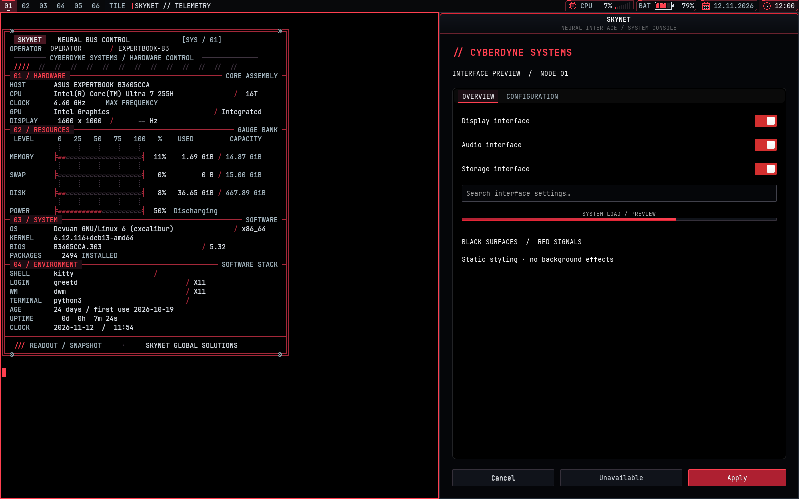

# SKYNET cyberpunk dokunuşu — 12 Kasım 2026

Genel rice, siyah/kırmızı SKYNET kimliği korunarak hafif cyberpunk vurgularla
birleştirildi. Ana renkler: siyah `#000000`, panel `#080a0e`, koyu seçim
`#481722`, kırmızı `#ff4050`, açık metin `#dde3ea`, çelik etiket `#a9bbc5`.

- GTK 3/4: ince kırmızı başlık çizgisi, koyu metalik başlık yüzeyi, 2 px
  köşeler, belirgin giriş odağı ve sekme işaretleri. İçerik yüzeyleri siyah.
  Devre dışı, hata/uyarı ve yıkıcı işlem stilleri ayrı kalır. Ek CSS kaynağı
  `sources/gtk-skynet/cyberpunk.css`; temel CSS derlendikten sonra her iki
  GTK sürümünün `gtk.css` dosyasının sonuna bir kez eklenir.
- Kitty: imleç, seçim, sekme ve arayüz renkleri. ANSI `color0`–`color255`
  tanımları, kısayollar, font boyutu ve render zamanlaması değişmez.
- Fastfetch: daha net kırmızı hatlar/ölçekler, çelik etiketler ve NEURAL BUS
  CONTROL başlığı. ASCII dünya, bütün modüller, veri alanları ve satır
  genişlikleri korunur. Ek animasyon veya resim protokolü yoktur.
- Dunst: ortak palet, 1 px çerçeve ve daha okunaklı ikincil OSD metinleri.
  Ses betiği, kuralların eşleşmeleri ve zaman aşımları korunur.
- DWM: 2 px odak çerçevesi, 1 px alt hat, koyu kırmızı seçili alanlar.
  Makinenin özel 6 px bar/status padding değerleri ve yerel kısayolları
  `devuan-source.patch` katmanında korunur. Göstergelerin veri/uyarı
  davranışı ve çalışma alanı düzeni değişmez.

Yeni daemon, ağ isteği, sürekli efekt veya paket eklenmedi. Sistem giriş,
kilit ve Polkit doğrulama kodları; PAM, güvenlik politikaları, sürücüler,
güç yönetimi ve VS Code sözdizimi ayarları değiştirilmedi.

## Doğrulama ve etkinleşme

Önceki DWM, önceki yapılandırma + yerel yama ile yeniden derlendi ve kurulu
ikiliyle byte düzeyinde eşleşti. Böylece yeni renklerin yerel özellikleri
kaybettirmediği doğrulandı. Son derleme uyarısız; yeni DWM SHA-256:
`abc7be105cfaf60510ce6e8b788717eb492264ce9cfc4d63bc39c8ed9f8bb46a`.
Normal Polkit doğrulamasıyla root:root 0755 olarak atomik kuruldu; çalışan
DWM oturumu kapatılmadı. Bar **sonraki oturum açılışında** etkinleşir.

GTK 3/4 CSS ayrıştırma hatası sıfır. Kimlik doğrulamalı ayrı Xephyr/özel D-Bus
ortamında yeni DWM, GTK örnek penceresi, Kitty/Fastfetch ve Dunst çalıştırıldı.
GTK, Kitty ve Dunst uygulama günlükleri boştu. Özel test ortamındaki portal
başlatma/kapanış uyarıları testin tam bir masaüstü oturumu olmamasından
kaynaklanır; bu uyarılar canlı sisteme yönelik bir onarımın konusu değildir.
İki mevcut pil ayrıştırma testi geçti. Fastfetch veri yer tutucuları ve renk
kodlarından arındırılmış satır uzunlukları öncekiyle eşleştirildi.

Kitty kendi SIGUSR1 yenilemesiyle, Dunst `dunstctl reload` ile etkinleştirildi.
Yeni GTK pencereleri tema dosyalarını okur; açık uygulamalarda tam görünüm
uygulama yeniden açılınca gelir. Fastfetch sonraki çalıştırmada yeni stili okur.

GTK örnek penceresi test arayüzüdür; yeni bir sistem ayar uygulaması değildir.
Fastfetch özel ekranın bilgilerini gösterir; önizlemede yer kazanmak için
ASCII logo yalnız bu test çağrısında gizlenmiştir. Kullanıcının logo ayarı korunur.
