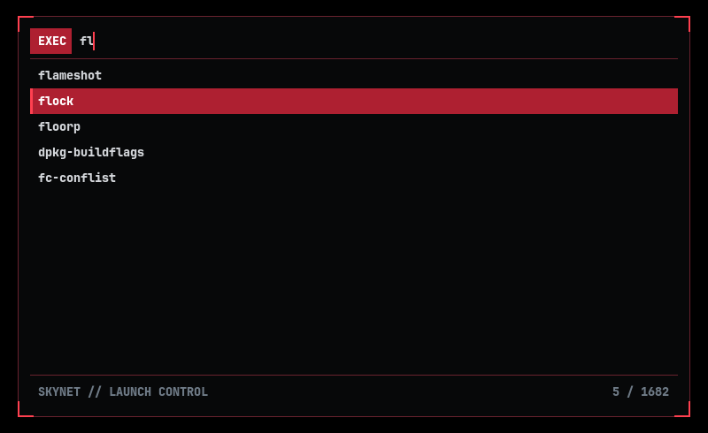
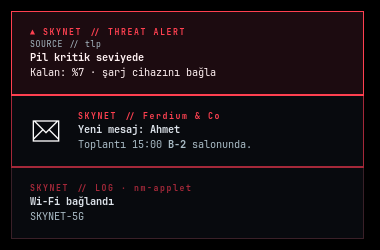
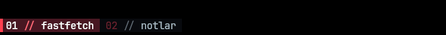
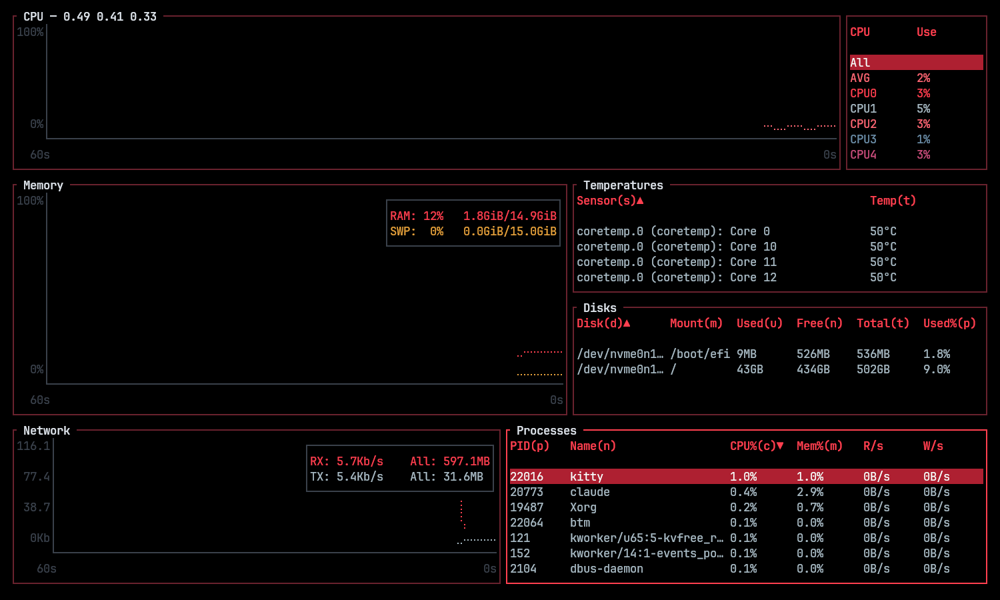

# SKYNET cyberpunk dokunuşu — 12 Kasım 2026

Genel rice, siyah/kırmızı SKYNET kimliği korunarak hafif cyberpunk vurgularla
birleştirildi. Ana renkler: siyah `#000000`, panel `#080a0e`, koyu seçim
`#481722`, kırmızı `#ff4050`, açık metin `#dde3ea`, çelik etiket `#a9bbc5`.

- GTK 3/4: ince kırmızı başlık çizgisi, koyu metalik başlık yüzeyi, 2 px
  köşeler, belirgin giriş odağı ve sekme işaretleri. İçerik yüzeyleri siyah.
  Devre dışı, hata/uyarı ve yıkıcı işlem stilleri ayrı kalır. Ek CSS kaynağı
  `sources/gtk-skynet/cyberpunk.css`; temel CSS derlendikten sonra her iki
  GTK sürümünün `gtk.css` dosyasının sonuna bir kez eklenir.
- Kitty: imleç, seçim, sekme ve arayüz renkleri. ANSI `color0`–`color255`
  tanımları, kısayollar, font boyutu ve render zamanlaması değişmez.
- Fastfetch: daha net kırmızı hatlar/ölçekler, çelik etiketler ve NEURAL BUS
  CONTROL başlığı. ASCII dünya, bütün modüller, veri alanları ve satır
  genişlikleri korunur. Ek animasyon veya resim protokolü yoktur.
- Dunst: ortak palet, 1 px çerçeve ve daha okunaklı ikincil OSD metinleri.
  Ses betiği, kuralların eşleşmeleri ve zaman aşımları korunur.
- DWM: 2 px odak çerçevesi, 1 px alt hat, koyu kırmızı seçili alanlar.
  Makinenin özel 6 px bar/status padding değerleri ve yerel kısayolları
  `devuan-source.patch` katmanında korunur. Göstergelerin veri/uyarı
  davranışı ve çalışma alanı düzeni değişmez.

Yeni daemon, ağ isteği, sürekli efekt veya paket eklenmedi. Sistem giriş,
kilit ve Polkit doğrulama kodları; PAM, güvenlik politikaları, sürücüler,
güç yönetimi ve VS Code sözdizimi ayarları değiştirilmedi.

## Doğrulama ve etkinleşme

Önceki DWM, önceki yapılandırma + yerel yama ile yeniden derlendi ve kurulu
ikiliyle byte düzeyinde eşleşti. Böylece yeni renklerin yerel özellikleri
kaybettirmediği doğrulandı. Son derleme uyarısız; yeni DWM SHA-256:
`abc7be105cfaf60510ce6e8b788717eb492264ce9cfc4d63bc39c8ed9f8bb46a`.
Normal Polkit doğrulamasıyla root:root 0755 olarak atomik kuruldu; çalışan
DWM oturumu kapatılmadı. Bar **sonraki oturum açılışında** etkinleşir.

GTK 3/4 CSS ayrıştırma hatası sıfır. Kimlik doğrulamalı ayrı Xephyr/özel D-Bus
ortamında yeni DWM, GTK örnek penceresi, Kitty/Fastfetch ve Dunst çalıştırıldı.
GTK, Kitty ve Dunst uygulama günlükleri boştu. Özel test ortamındaki portal
başlatma/kapanış uyarıları testin tam bir masaüstü oturumu olmamasından
kaynaklanır; bu uyarılar canlı sisteme yönelik bir onarımın konusu değildir.
İki mevcut pil ayrıştırma testi geçti. Fastfetch veri yer tutucuları ve renk
kodlarından arındırılmış satır uzunlukları öncekiyle eşleştirildi.

Kitty kendi SIGUSR1 yenilemesiyle, Dunst `dunstctl reload` ile etkinleştirildi.
Yeni GTK pencereleri tema dosyalarını okur; açık uygulamalarda tam görünüm
uygulama yeniden açılınca gelir. Fastfetch sonraki çalıştırmada yeni stili okur.

GTK örnek penceresi test arayüzüdür; yeni bir sistem ayar uygulaması değildir.
Fastfetch özel ekranın bilgilerini gösterir; önizlemede yer kazanmak için
ASCII logo yalnız bu test çağrısında gizlenmiştir. Kullanıcının logo ayarı korunur.

## Terminal paleti, dmenu paneli ve Bluetooth simgesi — 20 Kasım 2026

Canlı masaüstünde kalan üç uyumsuzluk aynı siyah/kırmızı/çelik dile taşındı.
Bar, GTK, Dunst, Fastfetch, Bash istemi ve kilit/giriş ekranları değişmedi.

**Kitty ANSI paleti.** `current-theme.conf` artık `color0`–`color15`
tanımlar; önceden Kitty'nin varsayılan yeşil/mavi/sarı tonları `ls`, `git`
ve editör renklerinde temanın dışına çıkıyordu. Kırmızı (`color1`) imleçle
aynı `#ff4050` sinyalidir; diğer tonlar kırmızı baskın kalsın diye
doygunluğu düşük tutuldu: başarı/ekleme soğuk turkuaz `#3fbfa8`, uyarı amber
`#e8a33d`, dizinler çelik mavisi `#6c8ea8`, veri camgöbeği `#4fc3cf`.
Fastfetch ve Bash istemi 24 bit renk kullandığı için etkilenmez.
Etkinleştirme Kitty'nin SIGUSR1 yenilemesiyle yapıldı. Önceki canlı dosya
`~/.config/kitty/current-theme.conf.bak-20261120` olarak saklandı.

**dmenu paneli.** Alt+P artık ekranın ortasında, 760 px genişliğinde,
12 satırlık bir panel açar: kilit ekranındaki gibi ince koyu kırmızı
çerçeve (`#69222E`) ve parlak köşe parantezleri (`#FF4050`), `EXEC` rozeti,
kırmızı imleç, seçili satırda parlak kırmızı kenar ve altta
`SKYNET // LAUNCH CONTROL` ile `eşleşme / toplam` sayacı. DWM'nin geçirdiği
font ve renk argümanları aynen kullanılır; DWM yeniden derlenmedi ve oturum
yeniden başlatılmadan bir sonraki Alt+P'de etkinleşir. `-t` klasik tam
genişlik çubuğu, `-l 0` yatay listeyi geri getirir; `-w` ile gömülü
kullanımda panel çizilmez. Ayarlar `sources/dmenu/config.h` içindeki
`hudwidth`, `hudpad`, `hudgap`, `hudcorner`, `rowpad`, `hudlabel`
değerleridir. Upstream `config.def.h` paneli kapalı tutar.

Kurulu eski ikili, repodaki önceki kaynakla byte düzeyinde eşleşti (yerel
yama yoktu). Yeni ikili root:root 0755 olarak atomik kuruldu; man sayfası
`/usr/local/share/man/man1/dmenu.1`. Yedek:
`~/.local/share/dwm-theme-backups/before-dmenu-hud-20261120T092830Z/`.
Yeni dmenu SHA-256:
`e058f5a868a8815fbcf8cdc49540a428ab6aa03837a4d161182d72a4d77cc458`.

**Bluetooth tepsi simgesi.** blueman'ın renkli mavi simgesi, tepsideki
breeze-dark Wi-Fi simgesiyle aynı beyaz (`#fcfcfc`) tek renkli Bluetooth
işaretiyle değiştirildi: açık, bağlı (iki yan nokta) ve kapalı (soluk,
çizgili). İşaret, breeze simgelerindeki kenar payına uysun diye
tuvalin yaklaşık %60'ına ölçeklenir; canlı barda 18 px yüksekliğindedir
(ilk sürüm 28 px ile barın tamamını kaplıyordu). Dosyalar `~/.local/share/icons/hicolor/<boyut>/status/` altında
`blueman-tray`, `blueman-active`, `blueman-disabled` adlarıyla durur;
hicolor sabit boyut dizinlerini `scalable/` öncesinde aradığı için tepsinin
isteyebileceği her boyutta kopya gerekir. blueman'ın
`symbolic-status-icons` seçeneği bilinçli olarak kapalı kalır: DWM tepsisi
`_NET_SYSTEM_TRAY_COLORS` yayınlamadığından symbolic simgeler siyah çizilir.
SVG başlığında XML bildirimi ile `<svg>` arasına uzun yorum konursa
gdk-pixbuf dosyayı tanımıyor ve tepside "image-missing" görünüyor; yorum
bu yüzden `<svg>` içindedir. Etkinleştirme için yalnız `blueman-tray`
yeniden başlatıldı; Bluetooth bağlantıları etkilenmedi.

Doğrulama: `tests/test_theme_assets.py` (paletin 16 rengi, simgelerin her
boyutta varlığı/yüklenebilirliği, dmenu'nün canlı ve upstream
yapılandırmayla uyarısız derlenmesi). dmenu, ayrı Xephyr ekranında gerçek
`dmenu_run` ile; palet ayrı Kitty penceresinde `ls`/`git diff` ile;
simge canlı tepside ekran görüntüsüyle kontrol edildi. `scripts/build.py`
dmenu'yü derledi, ardından `valac` kurulu olmadığı için snixembed adımında
durdu; bu, bu değişiklikten bağımsız mevcut bir ortam eksikliğidir.

## Bildirimler, Kitty sekmeleri ve bottom — 20 Kasım 2026

Hedef: duvar kâğıdı ve DWM düzeni aynı kalırken Terminator'daki Skynet
arayüzüne ve cyberpunk HUD diline yaklaşmak. Yalnız kullanıcı yapılandırması
değişti; yeni paket, süreç veya animasyon yoktur.

**Dunst.** Ses/parlaklık OSD'leri zaten `SKYNET / AUDIO` gibi başlıklar
taşıyordu; genel bildirimler de aynı dile alındı:

- Normal: harf aralıklı kırmızı `SKYNET // <uygulama>` başlığı, beyaz özet,
  çelik gövde.
- Düşük: soluk kırmızı `SKYNET // LOG · <uygulama>` ve daha sönük çerçeve
  `#3a2028`.
- Kritik: `▲ SKYNET // THREAT ALERT`, altında `SOURCE // <uygulama>`;
  mevcut kırmızı çerçeve ve koyu kırmızı zemin korunur.

OSD kuralları dosyada genel kurallardan sonra geldiği için kendi
biçimlerini korur. Uygulama adı dunst tarafından kaçırılır (`&` gibi
karakterler sorun çıkarmaz). Ses betiği, zaman aşımları ve eşleşmeler
değişmedi. `dunstctl reload` ile etkinleştirildi; yedek
`~/.config/dunst/dunstrc.bak-20261120`.

**Kitty.** 4×10 px iç boşluk (metin kırmızı DWM çerçevesine yapışmaz) ve
konsol kanalı gibi okunan sekme çubuğu: aktif sekme kırmızı `▌` kenar ile
`01 // başlık`, pasif sekmeler soluk. Sekme çubuğu yalnız iki veya daha fazla
sekmede görünür. `repaint_delay`, `input_delay`, `sync_to_monitor` korunur;
imleç izi gibi ek çizim yükü getiren seçenekler bilinçli olarak eklenmedi.
SIGUSR1 ile yenilendi; yedek `~/.config/kitty/kitty.conf.bak-20261120`.

**bottom (`btm`).** Varsayılan renkler yerine Skynet teşhis paleti:
kırmızı çerçeve/başlık/seçim, çelik etiketler, RAM kırmızı, önbellek çelik,
swap amber, ağ alımı kırmızı/gönderimi çelik, pil yüksek/orta/düşük için
beyaz/amber/kırmızı. Önceki dosya `~/.config/bottom/bottom.toml.bak-20261120`.

Kilit ekranına dokunulmadı: kutu, parmak izi doğrulama arayüzünü taşıyor ve
zaten aynı HUD dilinde.

Doğrulama: `tests/test_theme_assets.py` içindeki `HudStylingTest`
(bildirim başlıkları, OSD kural sırası, Kitty'nin statik kalması, bottom
renklerinin geçerliliği). Bildirimler ayrı D-Bus oturumu ve Xephyr'de,
ses kuralı çıkarılmış bir kopya yapılandırmayla; Kitty ve bottom ayrı
Xephyr ekranında render edildi.
