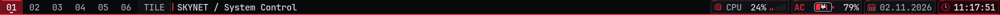
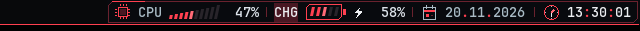

# SKYNET bar görünümü — 2 Kasım 2026

Bar, Fastfetch paneliyle aynı açık gri ve kırmızı paleti kullanır. Pencere
başlığının geniş kırmızı zemini koyu `#08090B` zemine dönüştürüldü; etkin
başlığın yanında ince kırmızı çizgi vardır. Seçili çalışma alanı `#74121E`
zemin ve `#F22B3D` üst çizgiyle ayrılır. Pencere içeren çalışma alanlarının
altında küçük açık renk işaret bulunur. Etiketler `01`–`06`, düzen isimleri
`TILE`, `FLOAT`, `MONO` olarak sadeleştirildi.

Bar yazısı JetBrains Mono SemiBold 13'tür. Tarih/saat değerleri korunur;
yalnız `DATE` ve `TIME` önekleri çizimde kaldırılır. Saat koyu kırmızı zeminde,
diğer durum alanları `#101114` panel zemininde gösterilir. İnce alt çizgi boyunca
kırmızı vurgu sürer. Dış boşluk veya yeni arka plan süreci eklenmez.

CPU yüzdesi, pilin yüzde/AC/CHG ayrımı, şarj şimşeği ve %0–10 düşük pil
uyarısı korunur. Sistem tepsisi kodu, slstatus veri biçimi ve örnekleme hızı,
klavye/fare kısayolları, pencere kuralları ve pencere odak çerçevesi değişmez.
Yüzen pencere işareti başlık alanının sağ ucuna taşınmıştır; uzun başlıklar
bu işarete ve durum göstergelerine yer bırakacak şekilde kısaltılır.

## Gösterge düzeni

Dört durum alanı, iki köşesi kırpılmış ince çerçeve ve kısa kırmızı üst
işaret kullanır. CPU bölümünde piksel çizimli işlemci, kesin sayısal yüzde
ve sekiz kademeli küçük yük ölçeği bulunur. Bu ölçek anlık yükü gösterir;
geçmiş veriyi temsil eden bir grafik değildir. Eksik veri `--%` kalır.

Yatay pil simgesinin gövdesi, doluluğu ve fiş/şimşek/uyarı simgeleri korunur.
Normal `BAT` etiketi gri, adaptöre bağlı bekleme `AC` kırmızıdır. Aktif şarjda
`CHG` koyu kırmızı rozet üzerinde açık renkle yazılır; panelin üst çizgisi de
kırmızı olur. %0–10 aralığında adaptör/şarj durumu yokken kırmızı yüzde,
uyarı üçgeni ve belirgin üst çizgi kullanılır. %11'de uyarı kalkar.

Tarihe takvim, saate kadran simgesi eklendi. Bütün simgeler mevcut Xlib
çizimleriyle üretilir; resim, ikon fontu, animasyon veya ek süreç gerekmez.
Saat/tarih içerikleri ve bütün veri kaynakları değişmez. Gerçek font
ölçülerinde durum alanlarının toplam genişliği 556 px, bar yüksekliği 30 px'dir.

## Derleme ve etkinleştirme

Kaynak değişiklikleri `sources/dwm/config.h` ve `sources/dwm/dwm.c` içindedir.
Makinedeki `~/.local/share/skynet-rice/devuan-source.patch` içindeki DWM
yapılandırma bölümü geçici kaynak kopyasına `patch --batch --fuzz=0 -p1`
ile uygulanır. Kompakt CPU çizimi artık doğrudan depo kaynağında olduğundan
yalnız eski `dwm.c` CPU yama bölümü kaldırılmıştır. Kompakt bar ölçülerini
ve mevcut tuş bağlarını taşıyan yapılandırma bölümü ile greeter/kilit
bölümleri birebir korunur. Ardından `make` ile yalnız DWM derlenir.
Gerçek oturumla aynı 96 DPI
ve yerel katman kullanıldığında bar yüksekliği 30 px'dir.

Doğrulanan ikili `/usr/local/bin/dwm` konumuna root:root, 0755 izinleriyle
atomik olarak kurulur. Çalışan DWM kapatılmaz. Bu sürümde canlı ayar yükleme
olmadığından görünüm **sonraki DWM oturum açılışında** etkinleşir.

## Doğrulama

- Yerel yama sıfır fuzz ile uygulandı; derleme uyarısız tamamlandı.
- `python3 -m unittest discover -s tests -p 'test_battery*.py' -v`: 6 test geçti.
- Yeni DWM, görünür masaüstünü değiştirmeyen, kimlik doğrulamalı özel Xephyr
  ekranında çalıştırıldı. Test autostart betikleri boştur; gerçek oturumun
  uygulamaları ve servisleri başlatılmaz.
- 1920×30 bar geometrisi, çalışma alanı geçişleri, uzun başlık, yüzen düzen,
  adaptör bağlı bekleme, şarj, %10/%11 pil sınırı ve eksik veri görüntülendi.
  Etkin çalışma alanı işaretinin yer değiştirmesi ve başlığın koyu zemini
  kontrol edildi.
- Gösterge güncellemesinde yeni ikili özel Xephyr ekranında tekrar sınandı:
  CPU %0/%13/%24/%100/eksik veri ve pil AC/CHG/%10/%11/eksik veri durumları.
  Çizim yordamlarında 29 yüzde/güç birleşiminin ölçülen ve çizilen genişliği
  aynı kaldı (556 px). Uzun başlıkla DWM çalışmaya devam etti. Veri ayrıştırma,
  pencere yönetimi ve tuş bağlarının önceki kaynakla aynı olduğu doğrulandı.

Aşağıdaki görüntü test verisi kullanır; gerçek masaüstünün başlıklarını veya
anlık sistem değerlerini içermez. Özel ekranda tepsi uygulamaları çalıştırılmaz.

Pil davranışı ve önceki doğrulamalar [BATTERY-BAR.md](BATTERY-BAR.md) içindedir.

## 12 Kasım 2026 stil güncellemesi

Güncel palet, çerçeve ölçüleri ve doğrulamalar [CYBERPUNK-STYLE.md](CYBERPUNK-STYLE.md) içinde.

## Birleşik durum paneli — 12 Kasım 2026

CPU, pil, tarih ve saat artık tek dış çerçeve ve ortak koyu zemin içinde
çizilir. Dört bağımsız kutu kaldırılmış, aralarına kısa/ince iç ayraçlar
eklenmiştir. Dış konturun iki köşesi kırpılmıştır; sol üstte kısa kırmızı
vurgu vardır. Bütün metinler, simgeler, alan genişlikleri, örnekleme süreleri,
şarj/AC ayrımı ve yalnız pil modunda %0–10 uyarısı korunur. Tepsi uygulamaları
kendi simgelerini göstermeye devam eder.

Önceki kaynak + yerel yapılandırma yaması kurulu ikiliyi byte düzeyinde
yeniden üretti. Değişiklikten sonra yalnız DWM yeniden derlendi; derleyici
uyarısı yok. İki pil ayrıştırma testi geçti. Özel kimlik doğrulamalı Xephyr
ortamında AC %80, pil %10, şarj %10 ve eksik veri durumları çizilip incelendi.
Yeni ikili normal Polkit doğrulamasıyla root:root 0755 olarak atomik kuruldu.
Çalışan oturum kapatılmadı; görünüm sonraki DWM girişinde etkinleşir.

SHA-256: `2753770ab888c075c94a7515444e0cc4223f33f1d2703afeb4e2f58c09a5546c`.
Geçici kaynaklar, derleme ürünleri ve test dosyaları temizlendi.

## Saat görünümü — 12 Kasım 2026

Saat/dakika açık beyaz, ilk ayraç SKYNET kırmızısı, saniye bölümü daha sakin
çelik rengiyle gösterilir. Aynı JetBrains Mono fontu ve sekiz karakterlik
`HH:MM:SS` alanı kullanılır; panel genişliği değişmez. Kırmızı kadranda dört
çeyrek işareti ve gösterilen saati yaklaşık 12 yönlü piksel ölçeğinde izleyen
akrep/yelkovan vardır. Bunun için yeni zamanlayıcı veya süreç eklenmez;
slstatus'un mevcut güncellemesi kullanılır. Tarih, batarya, CPU, tepsi,
birleşik çerçeve ve yerel kısayollar korunur.

Geçerli `HH:MM:SS` biçimi doğrulanmadan bölünmüş çizim/kadran kullanılmaz;
eksik ya da beklenmeyen metin değiştirilmeden gösterilir. Gün sınırları,
artık saniye ve bozuk girişler için iki test geçti. Özel Xephyr ekranında
16:28:54, 00:00:00, 23:59:59 ve --:--:-- durumları çizildi. Önceki ikili
kaynak + yerel yama ile birebir üretildi; yeni derleme uyarısız tamamlandı.
Kaynak değişikliği saat çizimi ve doğrulayıcısıyla sınırlıdır.

Yeni ikili normal Polkit doğrulamasıyla atomik kuruldu; çalışan oturum
kapatılmadı. Görünüm sonraki oturum girişinde etkinleşir. Geçici derleme ve
kurulum dosyaları temizlendi.

SHA-256: `f5c605ae836270441ec94e782c412f0cf8576e9bef214d0403aaa3b97f7f5412`.

## Gerçek CPU yük geçmişi — 12 Kasım 2026

CPU bölümünde işlemci simgesi ve kesin yüzde yanında 24 ölçümlük mini geçmiş
grafiği bulunur. Önceki sekiz basamaklı anlık ölçeğin yerine geçer. Yüzdenin
altındaki ince çizgi anlık yükü ayrıca gösterir; %85 ve üzerindeki sayısal
okuma kırmızı vurgulanır. Bu renk bir donanım arızası/sıcaklık alarmı değildir.

Geçmiş yalnız kök pencere durum metni güncellendiğinde eklenir; pencere odağı,
bar yeniden çizimi ve genişlik ölçümü geçmişi ilerletmez. slstatus normalde
saniyede bir günceller; grafik son 24 **ölçümü** gösterir, kesin duvar saati
ölçekli kayıt değildir. Eski noktalar solda, yeni nokta sağda açık renktedir.
0/50/100 için koyu referans noktaları vardır. Veri yoksa -1 ile boşluk tutulur;
sıfır yük uydurulmaz ve eksik örnek üzerinden çizgi birleştirilmez. Açılışta
henüz ölçülmeyen geçmiş boş kalır. Geçmiş DWM kapanınca sıfırlanır.

Sabit 24 tamsayılık halka tampon kullanılır. Yeni arka plan süreci, dosya
kaydı, zamanlayıcı veya ilave CPU ölçümü yoktur; mevcut slstatus ölçümü
kullanılır. Grafik 48 px; eski 30 px ölçeğe göre toplam alan yalnız 18 px
artar. Batarya/saat/tarih, birleşik çerçeve ve yerel kısayollar korunur.

Önceki ikili kaynak + yerel yama ile birebir üretildi. Yeni derleme uyarısız;
başlangıç/boş geçmiş, halka tampon taşması ve sıralaması, tekrar eden gerçek
örnekler, bozuk/eksik değerler için dört test geçti. Özel Xephyr ekranında
başlangıç, değişken yük, %100 yük ve eksik örnek aralıkları çizilip incelendi.
Önizleme verileri sentetiktir, cihazın o anki CPU yükünü göstermez.

Normal Polkit doğrulamasıyla ikili atomik kuruldu. Çalışan oturum kapatılmadı;
**sonraki DWM oturumunda** etkinleşir. Geçici kaynaklar ve kurulum dosyaları
temizlendi. SHA-256: `399d4221731fddfe7a14261289e1fe70c85ba429b4cc1238f7c4946f8781adcc`.

## CPU grafiğinin sadeleştirilmesi — 12 Kasım 2026

Kullanıcı büyük grafiği yoğun bulduğu için mevcut gerçek yük geçmişi
korunarak grafik 48×13 yerine 24×8 px boyutuna küçültüldü. Tek piksellik
kırmızı çizgi kullanılır; alan dolgusu, kılavuz noktaları, parlak uç karesi
ve yüzde altındaki ikinci yük çizgisi kaldırıldı. Sayısal yüzde ve %85+
kırmızı vurgu korunur. CPU alanı önceki sürümden 24 px daha dardır.

Değişiklik yalnız `cpupanel` çizimindedir; 24 örnekli geçmiş, veri toplama,
eksik değer davranışı, batarya/saat ve diğer bar işlevleri birebir korunur.
Önceki ikili yeniden derlenerek kurulu sürümle eşleştirildi. Yeni derleme
uyarısız; özel Xephyr ekranında değişken yük, %0/%100 ve eksik örneklerle
çizim kontrol edildi. Mevcut geçmiş mantığı değişmediği için bu görsel
revizyonda aynı birim testleri yeniden çalıştırılmadı.

Normal Polkit doğrulamasıyla atomik kuruldu; **sonraki oturum girişinde**
etkinleşir. Geçici dosyalar temizlendi. SHA-256:
`ddad38cee93e7ced96b8f7befcc2e6bcbd384433dcff32c75ad486985d479650`.

## Tarih/saat yazı hiyerarşisi — 12 Kasım 2026

Gün/ay ve saat/dakika ana JetBrains Mono boyutunda kalır. Yıl ve saniye
bölümleri 10 pt Medium ile daha küçük/çelik renkte çizilir. Ana rakamlar
arasındaki nokta/iki nokta kırmızıdır; bilgiler ve tarih/saat biçimleri
korunur. Takvim simgesi çelik kontur, kırmızı üst şerit ve sade tek hücreyle
yenilendi. Saati izleyen küçük kadran korunur. Yeni iç kutu, animasyon veya
zamanlayıcı eklenmez; birleşik panelin zemin ve ayraçları aynı kalır.

İkincil font yalnız DWM başlangıcında yüklenir, çıkışta serbest bırakılır.
Yüklenemezse ana fonta dönülür. Ölçüm ve çizim aynı fontları kullanır; her
çağrıda ana font geri yüklenir. Geçerli olmayan veya farklı biçimdeki metin
normal fontla değiştirilmeden gösterilir. CPU ve batarya çizimi değişmez.

Önceki ikili kaynak + yerel yama ile birebir üretildi. Yeni derleme uyarısız.
Özel Xephyr ekranında sekiz tarih/saat girişinde ölçülen ve çizilen genişliğin
eşit olduğu, ana fontun her çağrıdan sonra korunduğu ve font temizliğinin
çalıştığı doğrulandı. Gece yarısı, yıl değişimi, normal ve eksik veri için
dört bar önizlemesi alındı. Test düzeneğinin ilk çalışmasında DWM'nin normal
X hata işleyicisi eksikti; düzeneğe eklenip kontroller başarıyla tamamlandı.

Normal Polkit doğrulamasıyla root:root 0755 ikili atomik kuruldu. Çalışan
oturum kapatılmadı; sonraki oturum girişinde etkinleşir. Geçici test/derleme
ve kurulum dosyaları temizlendi. SHA-256:
`0d411da52ebb61bc6c934af0b4e5ccc97aef16e463848b81a0fb8284a8ea60fc`.

## Tek boyutlu sade tarih/saat — 12 Kasım 2026

Kullanıcı küçük yıl/saniye düzenini beğenmediği için bütün tarih/saat
rakamları yeniden ana fontun aynı boyutuna ve aynı hizaya alındı. Tarih
çelik gri, saat açık beyaz, her iki nokta/iki nokta ayracı kırmızıdır.
Bölümler arasındaki ek 3 px boşluk ve ikinci fontun yükleme/temizleme kodu
kaldırıldı. Takvim/kadran simgeleri, küçük CPU grafiği, batarya ve birleşik
panel korunur. Veri biçimi veya güncelleme aralığı değişmez.

Önceki ikili kaynak + yerel yama ile birebir üretildi. Yeni derleme uyarısız;
özel Xephyr ekranında normal tarih/saat, gece yarısı/yıl değişimi ve eksik
veri görünümü doğrulandı. Normal Polkit doğrulamasıyla atomik kuruldu.
Çalışan oturum kapatılmadı; sonraki girişte etkinleşir. Geçici dosyalar
temizlendi. SHA-256:
`34664f97e7e383d44a73a20510ee33d75a95f9bffbff0e828aef7ad5d3b7f50a`.

## CPU için beş bölmeli gösterge — 13 Kasım 2026

Kullanıcının isteğiyle geçmiş grafiği kaldırıldı. Yüzde yanında beş ince,
eğik dilim güncel yüke göre soldan sağa kırmızı dolar. Sayısal yüzde tam
ölçümü korur; dilimler yaklaşık 20 puanlık kademelerdir: %0'da boş,
%1–20'de bir, %21–40'ta iki, %41–60'ta üç, %61–80'de dört, %81–100'de beş.
%85 ve üzerindeki sayı kırmızı kalır. Eksik veri `--%` ve küçük düz çizgi
ile gösterilir; sıfır yük gibi değerlendirilmez. Alan 28 px genişliğindedir.

Geçmiş tamponu, kayıt/okuma yardımcıları ve durum güncellemesindeki kayıt
çağrısı kaldırıldı. Eski geçmiş testleri güncel CPU veri doğrulama testleriyle
`tests/test_cpu_panel.py` içinde değiştirildi. Yeni süreç, zamanlayıcı veya
kalıcı veri kaydı yoktur. Batarya, tarih/saat, tepsi ve birleşik panel aynı.

Önceki ikili kaynak + yerel yama ile birebir üretildi. Derleme uyarısız;
iki CPU veri doğrulama testi geçti. Özel Xephyr ekranında %7, %45, %100,
%0 ve eksik veri çizimleri kontrol edildi. Normal Polkit doğrulamasıyla
ikili atomik kuruldu; çalışan oturum kapatılmadı. **Sonraki DWM girişinde**
etkinleşir. Geçici kaynaklar ve kurulum dosyaları temizlendi.

SHA-256: `88ef793941c742cb20251c11d2e165bde452f92bef9f75702ae23c3c59578690`.

## Altıgen CPU göstergesi — 13 Kasım 2026

Beş eğik dilim yerine, 28 px alan içinde altı parçalı küçük bir altıgen
yük halkası kullanılır. Parçalar üst kenardan saat yönünde dolar; yanan
parça sayısı `ceil(yüzde * 6 / 100)` olur. %0'da halka sönük, %100'de
tam kırmızıdır. Ortadaki küçük çelik renkli nokta sabittir. Kesin yüzde
ve %85 üzerindeki kırmızı sayı korunur. Eksik veri `--%` ve çizgidir.

Yalnızca CPU çizimi değişir; panel genişliği, batarya, saat ve tarih aynı.
Yeni süreç, animasyon, zamanlayıcı veya yazı tipi kullanılmaz. Mevcut
ikili yerel config yamasıyla birebir yeniden üretildi. Aday uyarısız
derlendi, iki CPU veri testi geçti. Kimlik doğrulamalı özel Xephyr
ekranında %7, %45, %100, %0 ve eksik veri görünümleri kontrol edildi.

İlk Polkit isteği 127 koduyla sonuçlandı. Standart sudo parola
doğrulamasıyla atomik kurulum tamamlandı; yetki politikaları değişmedi.
Kurulu ikilinin SHA-256 özeti doğrulandı: `36227b013b68581837ab83ef62a69851be9475c1eaa39c3c2be526382cd78145`.
Çalışan oturum kapatılmadı; sonraki DWM girişinde etkinleşir. Bu işleme
ait geçici derleme, önizleme ve kurulum dosyaları temizlendi.

## Analog saat açı düzeltmesi — 13 Kasım 2026

Önceki 12 konumlu tablo, yelkovanı beş dakikaya yuvarlıyor ve akrebi
buçukta sonraki tam saate geçiriyordu. Artık ikisi de paneldeki HH:MM:SS
metninden hesaplanır. Akrep 12 saatte, yelkovan 60 dakikada bir tur atar;
saniye bileşeni her iki açıya katılır. Sinüs/kosinüs ile hesaplanan uç
koordinatları yalnız son aşamada en yakın piksele yuvarlanır. Simgenin
14 px çapı nedeniyle her saniye görünür hareket beklenmez; ayrı saniye
kolu yoktur. Kırmızı kısa akrep ve açık renkli uzun yelkovan korunur.

Sistem saati/saat dilimi veya slstatus değiştirilmedi; yeni zamanlayıcı
yoktur. DWM standart matematik kütüphanesine (`-lm`) bağlanır. Eksik/geçersiz
saatte kollar çizilmez. CPU, batarya, tarih ve panel ölçüleri aynı.

Mevcut ikili yerel config yamasıyla birebir yeniden üretildi. Yeni derleme
uyarısız; saat/CPU/batarya için 10 test geçti. Yeni testler yönleri, ara
dakikaları, saniye etkisini, buçuktaki akrebi ve gün dönüşünü kapsar.
Özel kimlik doğrulamalı Xephyr ekranında altı saat durumu kontrol edildi.

Standart sudo doğrulamasıyla atomik kuruldu. Kurulu SHA-256 doğrulandı:
`b21a6ba9501734ee40465721873a194578c8d93d16fea3f0af31d899d520975c`. Çalışan oturum kapatılmadı; düzeltme sonraki DWM
girişinde etkinleşir. Bu işe ait geçici dosyalar temizlendi.

## Akrep okunurluğu — 13 Kasım 2026

Akrep yarıçapı 3 px'den 4 px'e, çizgi kalınlığı 1 px'den 2 px'e
çıkarıldı. Mevcut paletin daha açık kırmızısı `#FF6A76` kullanılır.
Kısa kolu örten 2×2 merkez karesi kaldırıldı. Akrep çizildikten sonra
ortak çizim bağlamı başlangıçtaki 1 px çizgi ayarına geri alınır; diğer
göstergeler kalınlaşmaz. Beyaz yelkovan 5 px, kadran çapı 14 px kalır.
Açı hesabı, sayısal saat ve panel genişliği değişmedi.

Önceki ikili yerel config yamasıyla birebir üretildi. Yeni derleme uyarısız;
altı mevcut saat testi geçti. Özel Xephyr ekranında 12:30, 03:30, 09:00,
12:00 ve 10:10 çizimleri kontrol edildi.

Standart sudo doğrulamasıyla atomik kuruldu; kurulu SHA-256 doğrulandı:
`29cad7b645ef2607b3b3bf6965b774007cedfb1af2c88dc923d9e2d906b9499f`. Çalışan oturum kapatılmadı; değişiklik sonraki
DWM girişinde etkinleşir. Bu işe ait geçici dosyalar temizlendi.

## CPU rampası ve köşeli pil — 20 Kasım 2026

Bar düzeni, tuşlar, veri kaynakları ve slstatus biçimi değişmeden iki gösterge
Skynet HUD diline alındı. İkisi de etiket → grafik → değer sırasını ve
fastfetch panelindeki `////` eğimini paylaşır.

- **CPU:** Altıgen kadran yerine soldan sağa yükselen 10 eğik çubuk. Her
  çubuk başlamış bir %10 dilimidir (`%1` → 1, `%47` → 5, `%91` → 10);
  `%0` ve geçersiz veri tamamen sönüktür. Dolu kısmın uç çubuğu daha açık
  kırmızıdır (`#FF6A76`). Yüzde sağ uca taşındı; %85 ve üstü yine kırmızıdır.
- **Pil:** Yuvarlak gövde yerine durum çerçevesindeki gibi sol üst ve sağ alt
  köşesi kırpık bir gövde; içinde 5 eğik hücre. Hücreler en yakın %20'ye
  yuvarlanır, ancak sıfırdan büyük her şarj en az bir hücre gösterir. Son
  dolu hücre daha açıktır; kritik seviyede (≤%10, adaptörsüz) hücre ve
  gövde düz kırmızı kalır. `BAT`/`AC`/`CHG` etiketi, şimşek/fiş/uyarı
  rozetleri ve tam sayı yüzde korunur.

Eğik çubuk ve hücrelerin yan kenarları XRender ile kenar yumuşatmalı
(antialiased) çizilir; alt ve üst kenarlar tam piksele oturur. İlk sürüm
Xlib `XFillPolygon` kullanıyordu ve 3 px genişlikte basamaklı/pikselli
görünüyordu. Bu nedenle `config.mk` artık `-lXrender` ile bağlar
(`libxrender-dev` zaten derleme bağımlılıklarında). Pil gövdesinin kırpık
köşeleri, durum çerçevesiyle aynı 1 px Xlib çizgisidir.

Durum alanı yaklaşık 24 px genişledi; pencere başlığı buna göre kısalır.
Hesaplama `cpulitbars()` ve `batterylitcells()` fonksiyonlarındadır ve
`tests/test_cpu_panel.py` ile sınanır.

Derleme önceki yöntemle yapıldı (depo kaynağı + yerel `devuan-source.patch`
DWM bölümü). Değişiklikten önce aynı yöntemle derlenen ikilinin kurulu
DWM ile byte düzeyinde eşleştiği doğrulandı. Kenar yumuşatmalı sürümün SHA-256'sı
`b81c6aae15791df2818e5b212c56201511b280675db3da00e931d34efb4ea14c` idi;
aynı gün yapılan kod temizliğinden sonra kurulu DWM:
`f90c8817101d6e3d1244c421d2d78a4068aac10be28528f598b705f26a838d0a`
(durum alanı piksel düzeyinde aynı; bkz. `docs/MAINTENANCE.md`).
Önceki ikili ve `dwm.c`:
`~/.local/share/dwm-theme-backups/before-bar-ramp-20261120T103005Z/`.
Yeni görünüm **sonraki DWM oturum açılışında** etkinleşir. Önizleme,
autostart'sız Xephyr oturumunda kurulu ikiliyle alındı.

