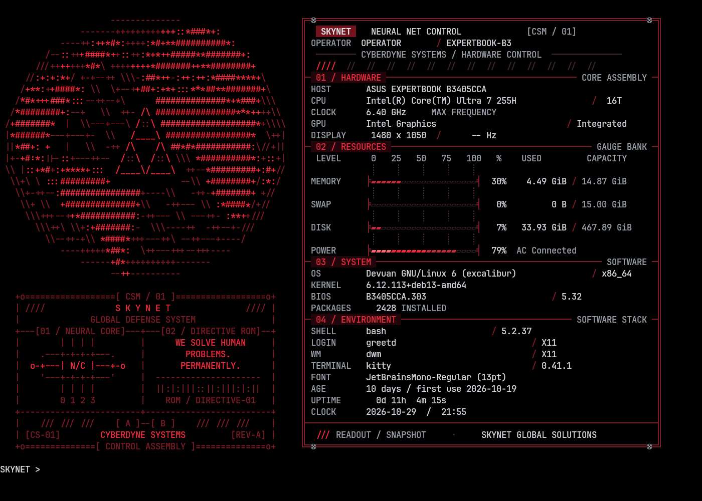
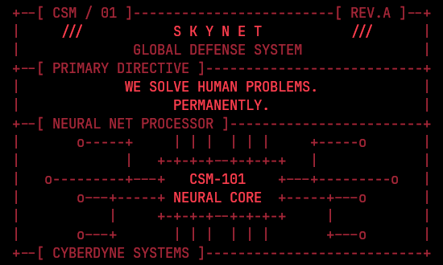

# SKYNET ASCII küresi ve analog sistem bilgi paneli

Fastfetch doğrudan `/usr/bin/fastfetch` üzerinden çalışır. Kullanıcının verdiği
kırmızı/beyaz dünya görseli, saf ASCII küreye çevrilmiş ve altına çerçeveli,
okunaklı `S K Y N E T` yazısı eklenmiştir. Kürenin merkezinde, çekirdek
görünümü veren küçük, üç parçalı bir ASCII SKYNET üçgeni vardır. Son kullanıcı seçimiyle logo **sabittir**. GIF,
terminal resim protokolü, animasyon süreci veya `~/.local/bin/fastfetch`
ara başlatıcısı kullanılmaz.

## Saf ASCII logo

`home/.config/fastfetch/skynet-globe.txt`, 56 sütun × 38 satır metindir:
23 satır küre, bir boşluk ve 14 satırlık ASCII kontrol plakası.
Görünen bütün logo karakterleri ASCII'dir; resim içine çizilmiş yazı değildir.
`$1`/`$2`/`$3` işaretleri Fastfetch'in standart metin rengi etiketleridir. Kıtalar
ve SKYNET yazısı parlak kırmızı, ince çizgiler koyu kırmızı gösterilir.
Merkez üçgeni 12 sütun × 6 satırda üç ayrı üçgen yüzeyden oluşur.
Parlak kırmızı `/`, `\` ve `_` dış çizgileri, koyu kırmızı `:` iç dokusunu
çevreler. Etrafındaki dar boşluk, simgeyi kıtalardan ayırır.

Kaynak, kullanıcının `~/Downloads/Kırmızı Beyaz Dünya Küresi.png` dosyasıdır;
orijinali değiştirilmedi. Bir defalık dönüşümde kırmızı yoğunluğu
`R - max(G, B)` ile ayrıldı. 70 üzerindeki piksellerin sınırı kırpılıp
10×23 terminal hücresi oranıyla 56×23 örneğe küçültüldü.
Son detaylandırmada kaynak görseldeki ince çizgiler, kıta maskesinden 13 piksel
genişliğinde aşındırma/genişletme işlemiyle ayrıldı. Hücre başına kara oranı
örneklenerek kıyılarda `:` ve `+`, daha dolu alanlarda `*` ve `#` kullanıldı;
böylece küçük kıyı çıkıntıları ve adalar daha iyi temsil edilir.
Denizlerde kürenin yüzeyini izleyen enlem-boylam çizgileri vardır.
Ağ 12 derece aralıklı geometrik eğrilerden bir
defalığına metne dönüştürülür; `-`, `/`, `\`, `|` ve kesişimlerde `+`
karakterleri kullanılır. Koyu kırmızı ağ, parlak kırmızı kıtalardan ayrılır;
üçgen ve etrafındaki boşluk yalnız kürenin merkezindeki küçük alanı kaplar.
PNG çalışma zamanında okunmaz; kaynak kopyası, çizgi üreticisi veya resim
üreticisi kurulmaz.

Yapılandırma `logo.type = file` ve
`logo.source = ~/.config/fastfetch/skynet-globe.txt` kullanır. Ev dizinini
Fastfetch kendisi genişletir; geri yükleyicide kullanıcıya özel yol yazımı
gerekmez. Önceki büyük `#` harfleri okunaklı olmadığı için başlık doğrudan
`S K Y N E T` metnine çevrildi; koyu kırmızı kutu içinde parlak kırmızı gösterilir.
Kürenin altındaki plaka 52 sütundur; iki yandaki boşluklarla logo 56 sütun
kalır. Üstünde `S K Y N E T` ve `GLOBAL DEFENSE SYSTEM`, tam genişlikteki
`PRIMARY DIRECTIVE` bölümünde iki satırlık `WE SOLVE HUMAN PROBLEMS.` /
`PERMANENTLY.` sloganı bulunur. `NEURAL NET PROCESSOR` bölümü altı satırlık
simetrik ASCII devredir: `CSM-101 / NEURAL CORE` çipi, altı üst ve altı alt pin,
yan bağlantılar, dallanan yollar ve sekiz yuvarlak bağlantı ucu içerir.
`CYBERDYNE SYSTEMS` alt çerçeveye yerleştirilmiştir. Bunlar dekoratif
etiketlerdir; donanım modeli, canlı sistem ölçümü veya hizmet durumu değildir.
Bütün çerçeve kenarları aynı sütunda hizalıdır. Toplam 38 satır korunur.

## Korunan sistem paneli

Panel 72 sütun genişliğindedir. Siyah/kırmızı palet, analog konsol çerçevesi,
köşe bağlantıları, numaralı bölümler ve 21 parçalı kaynak çubukları korunur.
Bütün başlıklar İngilizcedir. Donanım, kaynaklar, sistem ve yazılım ortamı
dört bölümde gösterilir. Mevcut 24 veri modülü girdisi ve renk dışındaki
`display` ayarları aynen korunmuştur; ağ modülü eklenmedi. Veri bulunamayan masaüstü
ve tema gibi satırları Fastfetch göstermez.

Sağ panel, soldaki logoyla aynı siyah zemin ve kırmızı vurguları kullanır.
Önceki krem/pembe-gri yazılar nötr griye çevrilmiştir. Kullanılan kaynak
miktarı açık gri; kapasite ve açıklamalar daha sakin gri gösterilir.

| Öğe | Renk |
| --- | --- |
| Zemin | `#000000` |
| Sistem değerleri | `#D4D7DC` |
| Etiketler, kapasite ve açıklamalar | `#9CA1AA` |
| Başlık ve vurgu | `#F22B3D` |
| Çerçeve ve ayırıcılar | `#7E1C27` |
| Yardımcı çizgiler ve boş çubuklar | `#44282F` |
| Bölüm başlığı zemini | `#22060C` |
| SKYNET isim plakası zemini | `#74121E` |

Kaynak çubukları `#C22D3D`, `#F22B3D` ve `#FF6A76` kırmızı tonlarını
kullanır; yüzde eşikleri ve veri anlamları değiştirilmemiştir.

Ölçülü Terminator vurgusu için üst başlık `NEURAL NET CONTROL`, panel etiketi
`[CSM / 01]` ve alt başlık `CYBERDYNE SYSTEMS / HARDWARE CONTROL` olarak
düzenlendi. Dört bölüm başlığının arkasında küçük koyu kırmızı şeritler vardır.
Bu yazılar tema etiketleridir; donanım modeli veya ölçüm bilgisi değildir.
Metalik gri sistem değerleri ve ana yerleşim korunur.

Bilgiler komutun çalıştığı andaki değerlerdir; sürekli güncellenen bir
izleyici değildir. Logo solda, panel sağdadır; birlikte 132 sütun gerekir.
Daha dar pencerelerde metin terminalin normal satır davranışına tabidir.
Yeniden boyutlandırma kancası, otomatik ekran temizleme veya arka plan
süreci eklenmedi.

## Kullanım ve temizlik

Yeni terminal ASCII logo ve paneli gösterir. Mevcut terminalde:

```sh
hash -r
fastfetch
```

Bu komutlar mevcut ekranı veya kaydırma geçmişini temizlemez. Logo seçilip
kopyalanabilir metindir; ayrı canlı görünüm veya çıkış tuşu yoktur.

Önceki Fastfetch GIF'i, eski logo kopyaları, iki özel başlatıcı, resim üreticisi
ve animasyon testleri kaldırılmıştır. Yeni logo yalnız `skynet-globe.txt`
dosyasını kullanır. Geçici dönüştürme ve önizleme dosyaları bırakılmaz.
Kitty, giriş/kilit ekranı, duvar kâğıdı ve Bash ayarları değiştirilmedi.

## AGE tarih kaynağı

AGE, kök dizinin doğum tarihine dayanmaz. Kullanıcının seçtiği ilk düzenli
kullanım tarihi 19 Ekim 2026'dır; 29 Ekim'de `10 days / first use 2026-10-19`
gösterir. Bu kullanım yaşıdır; kesin kurulum tarihi olduğu ileri sürülmez.

`home/.local/bin/skynet-os-age`, `$XDG_STATE_HOME/skynet-rice/first-use-date`
dosyasını okur; XDG değişkeni ayarlı değilse
`~/.local/state/skynet-rice/first-use-date` kullanılır. Dosya tek satır
`YYYY-MM-DD` içerir. Tarih cihazın yerel durumudur ve depoya kopyalanmaz.
Eksik, geçersiz veya gelecekteki tarihler `unknown` verir.

## Doğrulama — 29 Ekim 2026

Dört geri yükleme testi geçti. Logo düzenlemeleri sırasında logo dışındaki
yapılandırma alanları işlem öncesiyle birebir karşılaştırıldı.
Native Fastfetch çıktısı ASCII logonun yüklenmesini ve resim/imleç sorgusu/
ekran temizleme dizilerinin bulunmadığını doğruladı. Metin dosyasında renk
etiketleri çıkarıldığında bütün satırlar 56 ASCII karakterden oluşur.

Ayrı, görünmeyen ve kimlik doğrulamalı Xephyr ekranında Kitty 0.41.1 ile
1400×1000 önizleme alındı. 132 sütun toplam hizası, 56×38 ASCII logo,
38 satırlık panel, font satırı, komut girişi ve tekrar çağrıda önceki çıktının
korunması doğrulandı. Önizlemede kullanıcı/cihaz başlığı genelleştirildi;
ekran çözünürlüğü özel test ekranına aittir. Açık kullanıcı terminalleri
etkilenmedi; test süreçleri ve dosyaları temizlendi.



Başlık düzeltmesinde küre korundu. Ardından kullanıcı isteğiyle yalnızca
merkezdeki küçük alana üçgen ve boşluk payı yerleştirildi; haritanın diğer
hücreleri ve panel ayarları değişmedi. Özel Kitty önizlemesinde gerçek başlık
metni, merkez üçgeni, toplam hiza ve prompt görünürlüğü yeniden doğrulandı.

Üçgenin rengi kullanıcı düzeltmesiyle SKYNET kırmızısı `#F22B3D` yapıldı;
ASCII biçimi ve panel ayarları değiştirilmedi.

İlk enlem-boylam ağı güncellemesinde 56×27 boyut, bütün parlak kıta hücreleri,
merkez üçgeni ve başlık önceki metinle karşılaştırıldı. Fastfetch yapılandırması
bayt düzeyinde aynı kaldı. Yeni çizgiler native çıktıda ve özel Kitty
önizlemesinde kontrol edildi; belge görseli son görünümü gösterir.

Son detaylandırmada çizgi aralığı 15 dereceden 12 dereceye indirildi ve kıyı
geçişleri kaynak görselden yeniden örneklendi. 56×27 ölçü, merkez üçgeni,
başlık ve yapılandırma korundu. Native çıktı ve özel Kitty önizlemesinde
132 sütun hiza, font satırı ve komut girişinin görünürlüğü doğrulandı.

Alt boşluk düzenlemesinde kürenin 23 satırı, merkez üçgeni ve yapılandırma
aynen korundu. Başlık çerçevesi kontrol plakasına genişletildi; toplam logo
yüksekliği 27'den 38 satıra çıktı. Özel Kitty önizlemesinde iki alt çerçevenin
aynı satırda bitmesi ve promptun görünürlüğü kontrol edildi. Yeni bir süreç,
resim mekanizması veya başlangıç komutu eklenmedi.

Kontrol plakası detaylandırılırken toplam 56×38 boyut ve üstteki 23 satırlık
küre korundu. Fastfetch yapılandırması değiştirilmedi. Özel Kitty önizlemesi
132 sütun toplam genişliği, alt çerçevelerin hizasını, plaka yazılarını ve
prompt görünürlüğünü doğruladı. Belge görseli son tasarımla güncellendi.

Merkez üçgeni detaylandırmasında üç parçalı şekil 8×4'ten 12×6 hücreye
büyütüldü; kesintisiz dış çizgi ve koyu kırmızı iç doku kullanıldı. Merkez
ve çevresindeki dar boşluk dışında bütün logo hücreleri, alt kontrol plakası
ve Fastfetch yapılandırması korundu. Toplam 56×38 ölçü ve 132 sütun hiza,
native çıktı ve özel Kitty önizlemesiyle yeniden doğrulandı.
Son belge görüntüsü, iç içe test ekranındaki renk çizimini tamamlamak için
yalnız test terminalinde yazılımsal çizimle alındı; kurulu Kitty ayarları
değiştirilmedi.

Sağ panel paleti güncellemesinde yalnız RGB renk bileşenleri değiştirildi.
Bu bileşenler normalize edildiğinde eski ve yeni yapılandırma birebir
aynıdır; metinler, veri alanları, modül sırası ve ölçüler korunur. Logo
dosyası ve logo ayarları değişmedi. Native çıktı ve özel Kitty önizlemesinde
palet renkleri, 132 sütun hiza, alt çerçeveler ve prompt doğrulandı.

Terminator vurgusu güncellemesinde yalnız altı dekoratif satır değiştirildi:
üstteki iki başlık ile dört bölüm başlığının zemin rengi. Bütün veri modülleri,
logo dosyası/ayarları ve `display` ayarları birebir korundu. Native çıktı ve
özel Kitty önizlemesinde yeni etiketler, renkler, 72 sütun panel genişliği,
132 sütun toplam hiza ve prompt görünürlüğü doğrulandı.

## Alt kontrol plakası düzeltmesi — 13 Kasım 2026

Önceki sabit genişlikli metinde bazı sağ kenarlar farklı sütunlardaydı.
Yeni plakanın 14 satırında kenarlar aynı yerde (sıfır tabanlı sütun 2 ve 53).
Dar iki bölme yerine slogan tam genişlikte, devre şeması ayrı bölümde.
Dünya, merkez üçgeni ve üstteki 24 satır bayt düzeyinde korundu. Logo
38×56 saf ASCII olarak doğrulandı; Fastfetch yapılandırması ve sağdaki
sistem paneli değiştirilmedi. Kullanıcı logo dosyası atomik yenilendi.

Kimlik doğrulamalı ayrı Xephyr içinde Kitty/Fastfetch ile metin, kırmızı
palet, çip yolları, kenarlar ve prompt kontrol edildi. Önizleme ortamının
`NO_COLOR` değeri yalnız test sürecinden çıkarıldı. Komut başarıyla tamamlandı.
Aşağıdaki görüntü yalnız değişen alt panelin gerçek terminal görünümüdür.
Geçici tasarım, kurulum ve önizleme dosyaları temizlendi.


