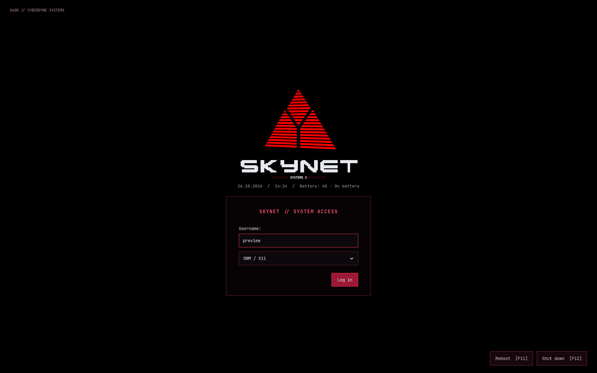
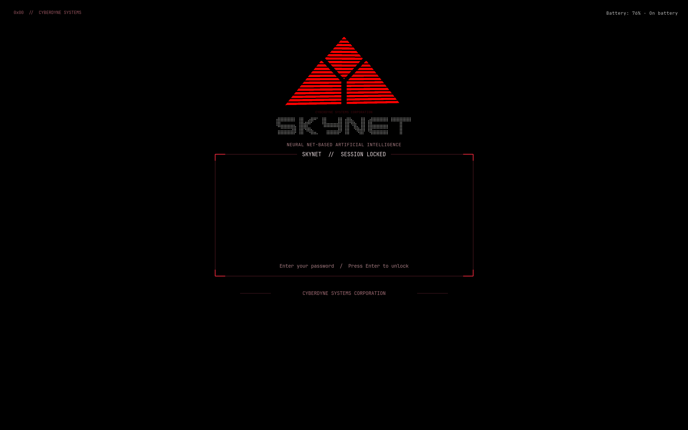

# Dönen SKYNET üçgeni — 26 Ekim 2026

11 Kasım 2026: açılışta bazen görülen ASCII logo, başlatıcının TTY yedeğidir.
Çizim değişmeden grafik başlangıç kurtarması eklendi; ayrıntılar ve sınırlar
[GREETER-STARTUP.md](GREETER-STARTUP.md) içindedir.

GTK greetd ve XSecureLock dekorunda yalnızca kırmızı, çizgili üçgen dikey
ekseni çevresinde döner. Tam tur dört saniyedir; hafif perspektif kullanılır.
Üçgen ve içindeki çizgiler birlikte hareket eder. SKYNET yazısı ve bütün
metinlerin yerleşimi sabittir. Küçük CYBERDYNE yazısının koyu kırmızı harfleri
üzerindeki eski beyaz ışık taraması, bağımsız 3,8 saniyelik döngüsüyle korunur.
Saat, pil bilgisi ve parmak izi sayacı kendi güncellemelerini sürdürür.

Yeni medya dosyası, oynatıcı, paket veya arka plan hizmeti kullanılmaz.
Mevcut yaklaşık 30 fps sınırı korunur. GTK çizimi görünmeyen pencerede durur;
kilit dekoru da gizliyken veya ekran karardığında animasyonu durdurur.

## AFK görünümünün düzeltilmesi — 27 Ekim 2026

Güç tuşu (`HandlePowerKey=lock`) ve beş dakikalık AFK kilidi aynı `xss-lock`
süreci üzerinden `/usr/local/libexec/skynet-lock` başlatıcısını kullanır.
Farklı görünen eski logo, ayrı bir kilitleyiciye yönlendirmeden kaynaklanmıyordu.
Dekor, X11 `ScreenSaverOn` durumunu fiziksel ekran kapanması saydığı için
AFK tetiklenince ilk animasyon karesini bile çizmiyordu; arka plan PNG'sindeki
eski noktalı üçgen görünür kalıyordu. Bu durum, `ScreenSaverOn` / `kind=Blanked`
olan özel Xephyr ekranında kurulu eski programla tekrar üretildi. Aynı program
X11 durumu sıfırlanınca animasyona başlıyordu.

`saver-lock-style.c` artık ekranın açık olup olmadığını DPMS'ten, dekorun
görünürlüğünü haritalama ve `VisibilityNotify` olaylarından öğrenir. AFK olayı
tek başına animasyonu durdurmaz. DPMS kapalıysa veya pencere gizli/tamamen örtülü
ise animasyon durur; kısmi örtülmede görünür logo hareket etmeye devam eder.
İlk kare ve boyut değişimi sonrasında güncel logo çizilmeden arka planın tamamı
gösterilmez. Böylece ilk açılışta eski bitmap'in gösterilmesi de önlenir.
[X11 ekran koruyucu durumları](https://xorg.freedesktop.org/archive/X11R7.6/doc/scrnsaverproto/saver.html).

Bu düzeltme yalnız `/usr/local/libexec/saver-lock-style` ikilisini değiştirir.
PAM, doğrulama yardımcıları, kilit çekirdeği, beş dakikalık AFK süresi, 12 saniyelik
kilit içi karartma ve güç tuşu politikası korunur. Greetd'deki logo kodu ve
kilitteki dört saniyelik dönüş/3,8 saniyelik yazı ışığı değiştirilmez. Sonraki
kilit açılışında etkinleşir; masaüstü veya kilit izleyicisi yeniden başlatılmaz.

Doğrulama: üç `test_lock_display_power.py` testi, açık/kapalı/standby/suspend,
devre dışı ve okunamayan DPMS durumlarını gerçek ekrana erişmeden sınar.
Özel Xephyr testinde güncel program AFK sırasında da hareket etti ve eski
bitmap'i göstermedi. Pencere gizlenince/tamamen örtülünce iki ayrı 0,7 saniyelik
ölçümde CPU zamanı artmadı; yeniden görünürken animasyon sürdü. Kısmi örtülme ve
yeniden boyutlandırma da sınandı. Gerçek oturum kilitlenmedi; PAM veya parmak izi
sensörü kullanılmadı. Fiziksel panelin DPMS kapanışı bu testte tetiklenmedi.

## Kaynak ve kurulum

Çizim değişiklikleri `sources/gtkgreet-skynet/skynet-logo.h` ve
`sources/xsecurelock-style/skynet-logo.h` içindedir. Yerel GTK sürümü için
[BIOMETRIC.md](BIOMETRIC.md) içindeki kaynak katmanlama yöntemi korunur:
geçici kaynak kopyasına mevcut `~/.local/share/skynet-rice/devuan-source.patch`
uygulanır, ardından `make` çalıştırılır. Bu yama değiştirilmemiştir.
Kilit dekorunun derleme bayrakları `scripts/build.py` içinde tanımlıdır.

Yalnızca `/usr/local/libexec/greetd/gtkgreet-skynet` ve
`/usr/local/libexec/saver-lock-style` atomik olarak, root:root / 0755
izinleriyle güncellenir. PAM, parmak izi yardımcıları, ana kilit programı,
greetd başlatıcısı ve yapılandırması değiştirilmez. Yeni görünüm, giriş ve
kilit ekranları bir sonraki açıldığında kullanılır; oturum yeniden başlatılmaz.

## Doğrulama

- Her iki program mevcut Devuan katmanıyla, yeni derleyici uyarısı olmadan
  derlendi; bağlantı kitaplıkları kontrol edildi.
- `python3 -m unittest discover -s tests -p test_logo_rotation.py -v`:
  üç widget boyutunda yalnızca üçgen ve küçük yazının ışığı değişir; büyük
  SKYNET yazısı sabit kalır. Üçgen dört saniyede ilk konumuna döner ve birinci
  saniyede yandan görünür. Küçük yazı 3,8 saniyede ilk ışık durumuna döner.
- Özel Xephyr ekranındaki XRender kontrolü de 65 örnek karede değişimin
  bu alanlarla sınırlı kaldığını ve iki döngünün ayrı sürelerini doğruladı.
  Önceki kurulumda gerçek dekor programının animasyonu,
  gizlenince düşük işlemci kullanımı, yeniden gösterilmesi ve klavyeyi
  yakalamadığı ayrıca kontrol edildi.
- Önceki kurulumda beş `test_greeter_protocol.py` testi geçti. Özel Cage/Wayland ekranında
  sahte greetd hizmetiyle parmak izi bekleme, hatalı parola reddi, yeniden
  deneme ve yalnızca başarı yanıtından sonra oturum isteği sınandı. Bu hız/ışık
  düzeltmesi sadece iki çizim başlığını değiştirir; doğrulama kaynakları korunur.
- Gerçek PAM, parola, parmak izi kaydı veya oturum kilitleme kullanılmadı.
  Korunan sistem dosyalarının SHA-256 değerleri kurulumdan sonra karşılaştırıldı.

Önizlemeler yalıtılmış 1920×1200 test ekranından alınmıştır. Kilit görüntüsü
yalnızca dekoru gösterir; parola/parmak izi paneli bu görüntüde çalıştırılmaz.

