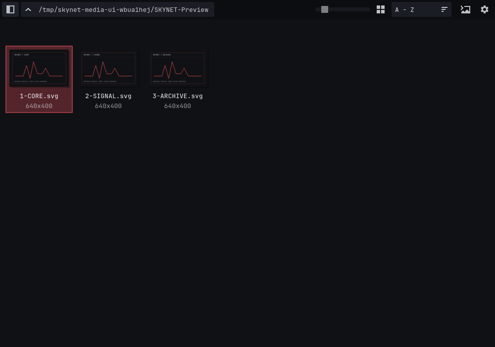
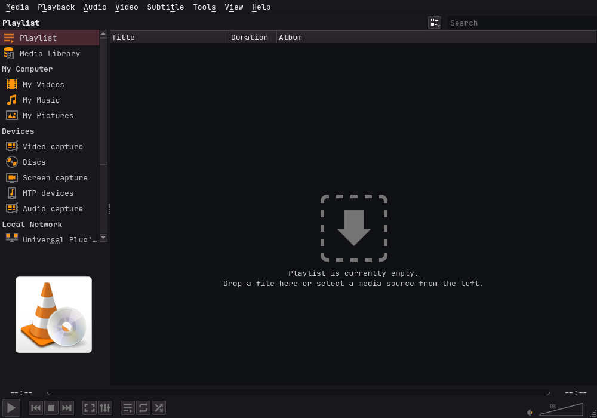

# qimgv ve VLC — SKYNET Industrial Red

VS Code arayüzüyle aynı siyah/antrasit, koyu kırmızı ve açık gri görünüm
uygulandı. Gerçek fotoğraflar veya videolar değiştirilmedi. Oynatma, ses,
altyazı, görüntü işleme ve dosya ilişkilendirme ayarları korundu.

## qimgv



`home/.config/qimgv/theme.conf` uygulamanın kendi tema dosyasıdır.
`tid=5` özel renk şemasını seçer. Ana yüzey `#101114`, tam ekran çevresi
`#08090c`, üst çubuk `#0c0d10`, vurgu `#b7434e`, yazı `#c7c9ce` oldu.
Programın `[General] useSystemColorScheme=false` ayarı zaten bu durumdaydı;
ana yapılandırma ve `savedState.conf` dosyaları değiştirilmedi.

`restore-home.py` tema dosyasını geri yükler. Başka kurulumda sistem paleti
kullanılıyorsa qimgv görünüm ayarlarından özel renk şemasına geçmek gerekir.
Resim ölçekleme, renk yönetimi, kısayollar, animasyon, video desteği ve
bulanıklaştırma seçenekleri değiştirilmedi.

## VLC



VLC 3.0.24'ün yerleşik koyu paleti özel kırmızı renkleri bastırdığı, GTK
platform teması ise testte açık renkli Fusion paletine döndüğü için dağıtımın
`qt5ct` ve zorunlu `libqt5ct-common1.8` paketleri kuruldu. Başka paket
yükseltilmedi veya kaldırılmadı. İki paketin toplam kurulu alanı yaklaşık
1 MiB'dir; qt5ct için bir arka plan hizmeti başlatılmaz.

Qt paleti `profiles/debian/rootfs/usr/share/qt5ct/colors/skynet-industrial.conf`
dosyasında korunur. Canlı karşılığı `/usr/share/qt5ct/colors/skynet-industrial.conf`,
root sahipliğinde `0644` izinlidir. `home/.config/qt5ct/qt5ct.conf` bu sabit
yolu, Fusion stilini ve mevcut Breeze Dark simgelerini seçer.

Yalnız VLC'nin normal başlatıcıları `QT_QPA_PLATFORMTHEME=qt5ct` kullanır:

- `home/.local/bin/vlc`, bütün medya argümanlarını aynen `/usr/bin/vlc`'ye iletir.
- `home/.local/share/applications/vlc.desktop`, standart başlatıcıyı yalnız
  bu ortam değişkeniyle çalıştırır; MIME türleri ve dosya argümanları korunur.

Oturumun genel `QT_QPA_PLATFORMTHEME=gtk3` değeri değiştirilmedi. Diğer Qt
uygulamaları qt5ct paletine geçirilmedi. Doğrudan `/usr/bin/vlc` çağıran özel
betikler kullanıcı başlatıcısını atlar; aynı görünüm için `vlc` komutunu veya
`env QT_QPA_PLATFORMTHEME=qt5ct /usr/bin/vlc` çağrısını kullanabilirler.

VLC'nin özel kullanıcı verilerini depoya almamak için tüm `vlcrc` veya
`vlc-qt-interface.conf` kopyalanmadı. `home/.config/skynet/vlc-ui.json`
yalnız gerekli görünüm tercihlerini kaydeder:

```ini
[qt]
qt-dark-palette=0
qt-slider-colours=96;48;56;150;48;60;198;83;92;226;116;125
```

`vlc-qt-interface.conf` içindeki `[MainWindow] QtStyle=Fusion` zaten ayarlıydı
ve dosya değiştirilmedi. Ses sürgüsü renkleri kırmızı tonlara çevrildi;
ses düzeyi veya izin verilen azami ses değeri değiştirilmedi.

Başka sisteme geri yükleme sırası:

1. `vlc`, `qimgv` ve `qt5ct` paketlerini kur.
2. Depodaki paleti `/usr/share/qt5ct/colors/skynet-industrial.conf` konumuna
   root sahipliğinde `0644` izinle kur. `restore-home.py` bu sistem dosyasını
   kurmaz; `build.py` de bu profil dosyasını otomatik sahnelemez.
3. Kullanıcı tema/başlatıcı dosyalarını `restore-home.py` ile geri yükle.
4. VLC'yi kapalı tutarak yukarıdaki iki `[qt]` seçeneğini mevcut dosyaya
   birleştir; diğer ayarları silme. VLC tercihlerinde Fusion stili seçili,
   uygulamanın kendi “Use a dark palette” seçeneği kapalı olmalıdır.
5. `update-desktop-database ~/.local/share/applications` çalıştır.

Bu makinede önceki `qt-dark-palette` değeri `1` idi; sürgü rengi için etkin
bir kullanıcı satırı yoktu. Geri almak için bu durumlara dön, eklenen VLC
başlatıcılarını kaldır. Önceki qimgv renkleri yerel `DOGRULAMA.json` içinde
korunur. Kullanılmaya devam eden paket/tema dosyalarını artık dosya sayma.

## Doğrulama

İki uygulama gizli Xephyr ekranında, ayrı D-Bus ve kullanıcı profilleriyle
denendi. qimgv'ye ait örnek SVG dosyaları yalnız önizleme için üretildi.
VLC önizlemesinde ses/video çıkışı kapalıydı; bu seçenekler gerçek kullanıcı
ayarlarına yazılmadı. Önizlemedeki devre dışı oynatma düğmeleri ve sıfır ses
göstergesi bu boş test oturumuna aittir.

VLC ana pencere, oynatma listesi ve ayar penceresi gözle kontrol edildi.
Son VLC önizlemesi, geçici paket kopyası yerine kurulu Qt eklentisiyle yapıldı.
qimgv ana ayarları/durum dosyası, VLC Qt durum dosyası ve MIME varsayılanları
hash karşılaştırmasıyla korundu. `vlcrc` farkı yalnız iki görünüm satırıdır.
Kabuk ve desktop başlatıcısı doğrulandı, Qt eklentisinin kütüphaneleri tam
bulundu ve dpkg denetimi temizdi. Geçici profiller, indirmeler ve test
dosyaları işlem sonunda kaldırıldı.

Kaynaklar: [qimgv tema yükleme](https://github.com/easymodo/qimgv/blob/master/qimgv/settings.cpp),
[qimgv renk şemaları](https://github.com/easymodo/qimgv/blob/master/qimgv/themestore.h),
[VLC Qt arayüzü](https://github.com/videolan/vlc/blob/3.0.24/modules/gui/qt/qt.cpp).
