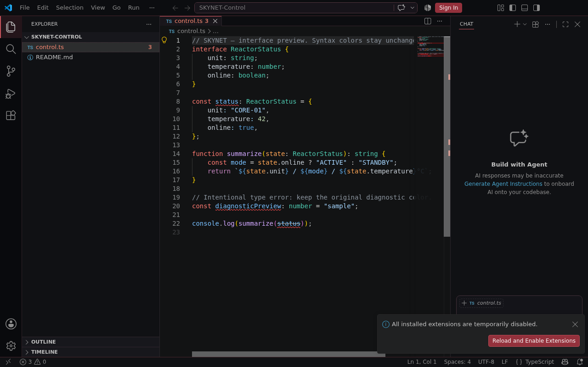

# VS Code — SKYNET Industrial Red

Kullanıcı yalnız uygulamanın görünümünü istedi; kodun syntax renklendirmesi,
hata/uyarı yazıları ve diğer anlamsal renkler korunmuştur. VS Code 1.143.1'de
yerleşik `workbench.colorCustomizations` kullanıldı. Tema eklentisi veya özel
CSS yükleyicisi kurulmadı; VS Code program dosyaları değiştirilmedi.

Önizleme geçici bir TypeScript örneğidir; altı çizili hatalar renklerin
korunduğunu denetlemek için bulunur. Gerçek proje dosyaları kullanılmadı.

## Görünüm ve kapsam

69 arayüz renk ayarı; siyah/antrasit başlık, kenar çubuğu ve paneller, koyu
kırmızı düğmeler, ince kırmızı sekme/odak çizgileri kullanır. Düğme yazısının
kontrastı normal durumda yaklaşık 6,64:1, üzerine gelince 5,15:1'dir.

`workbench.experimental.modernUI=false` bu sürümün yuvarlak yüzeyleri yerine
klasik köşeli düzeni seçer. `window.density.editorTabHeight=compact` yalnız
sekme yüksekliğini azaltır. `workbench.reduceMotion=on` ve
`workbench.reduceTransparency=on` hareket ve saydamlığı azaltır.

Temel `workbench.colorTheme`, token/semantic-token ayarları, kod yazı tipi ve
boyutu değiştirilmedi. Editörün zemin/yazı/seçim renkleri, terminal paleti,
hata/uyarı ve Git durum renklerine ek özelleştirme yapılmadı. Kullanıcının
diğer ayarları ve kurulu eklentileri korundu.

Bazı ortak liste renkleri VS Code tarafından editör işaretlerine veya uyarı
alanlarına miras verilir. İlk önizlemede saptanan bu etkiler nedeniyle
`list.activeSelectionBackground`, `list.inactiveSelectionBackground`,
`list.focusOutline`, `quickInputList.focusBackground` ve
`statusBarItem.hoverBackground` özelleştirmeye alınmadı.

## Geri yükleme ve geri alma

Taşınabilir arayüz ayarları `home/.config/skynet/vscode-ui.json` içindedir.
Canlı sistemde bu alanlar `~/.config/Code/User/settings.json` dosyasına
mevcut ayarlar korunarak birleştirildi. Kullanıcının bağlantı, hesap veya
projeye özel ayarları bu arayüz dosyasına alınmaz.

`restore-home.py` yalnız `~/.config/skynet/vscode-ui.json` önayarını geri
yükler; VS Code'un mevcut kullanıcı ayarlarını bununla değiştirmez. Başka
makinede VS Code'un **Preferences: Open User Settings (JSON)** komutunu açıp
önayardaki alanları birleştir. Mevcut `workbench.colorCustomizations` nesnesi
varsa yalnız önayardaki renk anahtarlarını ekle/güncelle; diğerlerini koru.

Bu makinede değişiklik öncesi bu beş görünüm alanı tanımlı değildi. Geri almak
için önayarın eklediği 69 rengi `workbench.colorCustomizations` içinden çıkar;
nesne boş kalırsa kaldır. Diğer dört görünüm ayarını da kaldır. Sonradan
eklenen kullanıcı ayarlarını silme. Önceki alanların varlığı/değerleri yerel
`DOGRULAMA.json` kaydında tutulur.

## Doğrulama

Gizli Xephyr ekranı, özel D-Bus oturumu, geçici HOME ve VS Code profili
kullanıldı. Yalnız geçici önizlemede ek eklentiler devre dışı bırakıldı;
kullanıcının eklenti durumu değiştirilmedi. Renk anahtarlarının tamamı
kurulu VS Code sürümünde bulundu.

Öncesi/sonrası tarayıcı karşılaştırmasında 363 renk değişkeni toplandı;
editör grubu çerçevesi ve sekme şeridi gibi kasıtlı arayüz değişiklikleri
dışında korunan alanlarda fark yoktu. Syntax token CSS kuralları birebir
aynıydı; görüntülenen 134 kod parçasının rengi, kalınlığı ve italik durumu
değişmedi. Üç gerçek TypeScript hata işareti önizlemede görünüyordu. Bu,
örnek dosya ve kurulu sürüm için doğrulamadır; her eklentinin özel webview
arayüzünün sistem renklerini izleyeceği varsayılmaz.

DevTools bağlantısı yalnız geçici profilde ve localhost üzerinde kullanıldı;
test bitince profil süreçleri, bağlantı, test dosyaları ve önbellekleri
kapatılıp temizlendi. Gerçek kullanıcı profiline debugging seçeneği eklenmedi.

Kaynak: [VS Code arayüz renkleri](https://code.visualstudio.com/api/references/theme-color).

## Yerleşik yapay zekâ özelliklerini kapatma

Kullanıcının 26 Ekim 2026 isteğiyle kullanıcı ayarlarına
`"chat.disableAIFeatures": true` eklendi. VS Code 1.143.1'de bulunan bu resmi
seçenek Copilot uzantılarını devre dışı bırakır; yerleşik sohbet ve yapay zekâ
satır içi önerileri gibi özellikleri kapatıp gizler. Genel
`editor.inlineSuggest.enabled` veya IntelliSense ayarları değiştirilmedi.
Dil araçları ve Jupyter korundu; başka üçüncü taraf AI eklentisi bulunmadı.

Bu davranış tercihi, renk önayarından ayrı olarak
`home/.config/skynet/vscode-no-ai.json` içinde korunur. Geri yüklerken içindeki
tek alanı VS Code kullanıcı ayarlarına birleştir; diğer ayarları değiştirme.
Geri almak için `chat.disableAIFeatures` alanını kaldır veya `false` yap.
Bir çalışma alanı bu ayarı açıkça farklı tanımlarsa kullanıcı ayarını geçersiz
kılabilir. Program/eklenti dosyaları silinmedi, açık editör oturumu zorla
yeniden başlatılmadı. Üstteki görsel yalnız renk önizlemesidir; AI özellikleri
kapatılmadan önceki geçici test oturumunu gösterir.

JSON ve diğer kullanıcı ayarlarının korunduğu, anahtarın kurulu sürümde
bulunduğu doğrulandı. Bu tek ayar için yeni GUI test profili oluşturulmadı.
Kaynak: [VS Code: AI özelliklerini kaldırma](https://code.visualstudio.com/docs/setup/copilot#_remove-ai-features-from-vs-code).
